<div align="center">

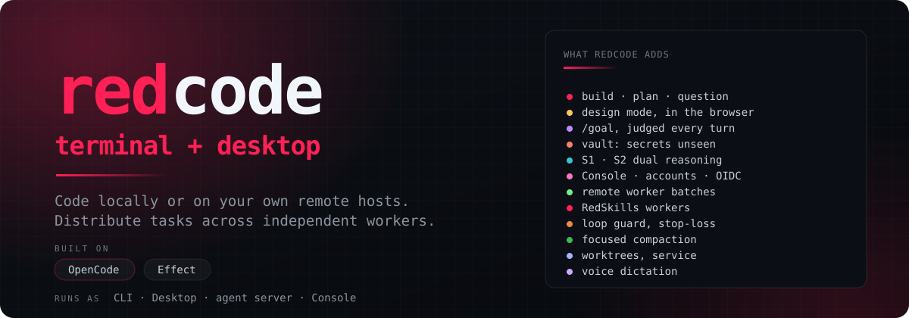

<p>
  <a href="https://www.npmjs.com/package/@reddb-io/redcode"></a>
  <a href="https://github.com/reddb-io/redcode/actions/workflows/redcode.yml"></a>
  <a href="LICENSE"></a>
</p>

<strong>An open-source AI coding assistant for your projects.</strong><br>
Open a project, describe the work and review the changes.

<p><a href="#desktop">Desktop</a> · <a href="#cli--tui">CLI</a> · <a href="#session-modes">Modes</a> · <a href="#features">Features</a> · <a href="#infrastructure">Servers & workers</a> · <a href="#console">Console</a></p>

</div>

## Get started

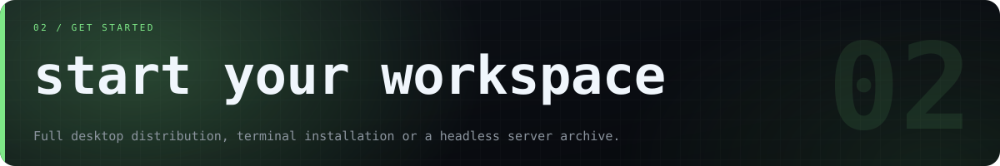

Choose the interface you prefer. Both work with your project's files and the model provider you connect.

### Desktop

**The visual app:** conversations, sessions, subagents and Design review in one workspace.

On phones, the shared web workspace uses a header navigation menu and overlay sidemenus so the
conversation keeps the full screen width. [Remote access](docs/remote-access.md).

Open **Agents** in the siderail to follow sessions across hosts, answer requests in **Inbox**, inspect
**Hosts and resources**, or manage **Remote workers**. This workspace shows agent metadata; opening a
session loads its conversation. [Agents workspace](docs/agent-features.md#agents-workspace).

**Harnesses** runs installed Claude Code and Codex on the selected host. **Machines** guides remote
connection, inspection and worker registration. **Worktrees** creates isolated checkouts, reviews and
commits results, integrates a reviewed commit and archives/restores detached worktrees.
Configuration is available in the app; **Settings → Servers** links to each host's tools.
[External agents and worktree workflow](docs/external-harnesses.md).

**Settings → Agent tools** configures optional Rift snapshots, browser control, terminal control and
computer use on the selected execution host. Installation and enablement are explicit; CLI and TUI
share those settings. [Capabilities and setup](docs/agent-tools.md).

With mise installed, run:

```sh
mise use -g github:reddb-io/redcode@latest
redcode desktop
```

Or download a **full native archive** from [Releases](https://github.com/reddb-io/redcode/releases).
Open your project and use **Connect provider** to add a model.

<details>
<summary>See the Desktop / web workspace</summary>

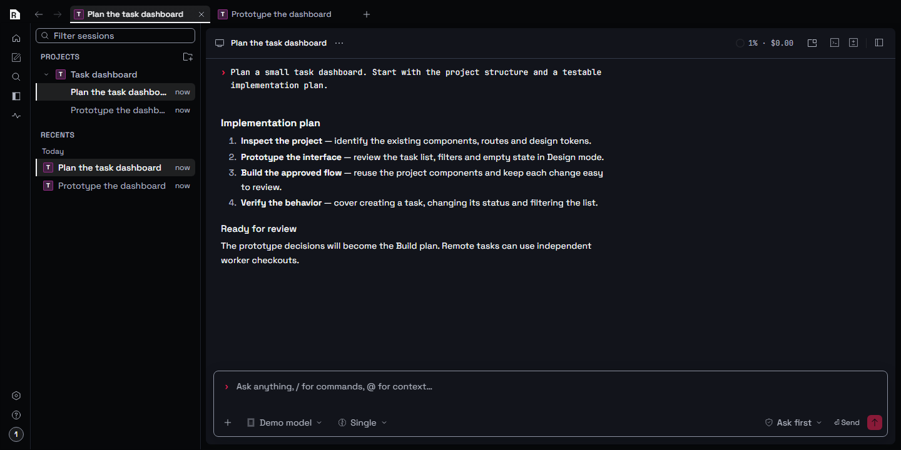

_The web workspace shared with Desktop, with a demonstration conversation._

</details>

### CLI / TUI

**The terminal app:** the interactive coding conversation runs inside your terminal.

```sh
npm install -g @reddb-io/redcode
cd your-project
redcode
```

Inside the TUI, use `/connect` to add a model provider, then describe your task.
Use `/agent-tools` or `redcode tools` to configure the host's optional browser, terminal, desktop and
snapshot capabilities. [Agent tools](docs/agent-tools.md).
The npm package includes the coding engine and Design; Desktop uses the full distribution above.

[Installation and platforms](docs/installation.md) · [Client commands and history imports](docs/clients.md)

## Session modes

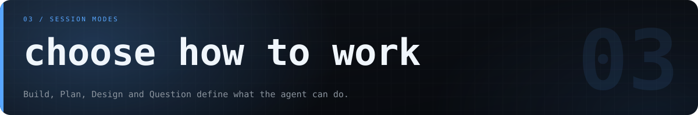

A mode defines what the agent does in your conversation.

<table>
<tr>
<td width="50%">
<a id="build"></a>
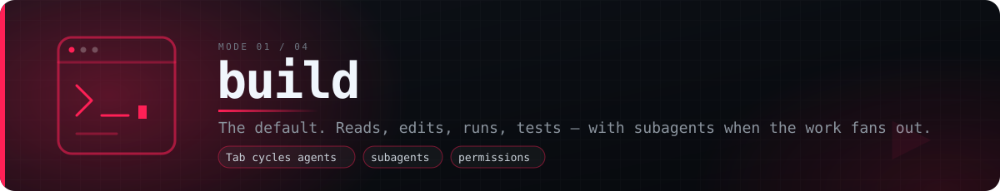
<p><strong>Build</strong> edits files, runs commands and implements the task.</p>
</td>
<td width="50%">
<a id="plan"></a>
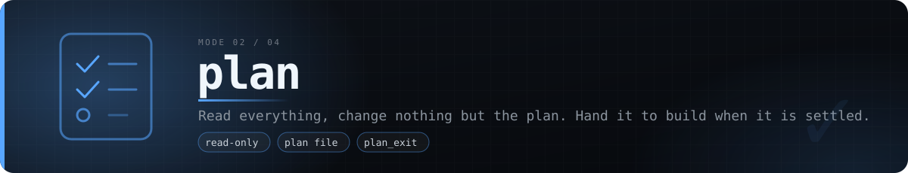
<p><strong>Plan</strong> explores the project and writes a plan before implementation.</p>
</td>
</tr>
<tr>
<td width="50%">
<a id="design"></a>
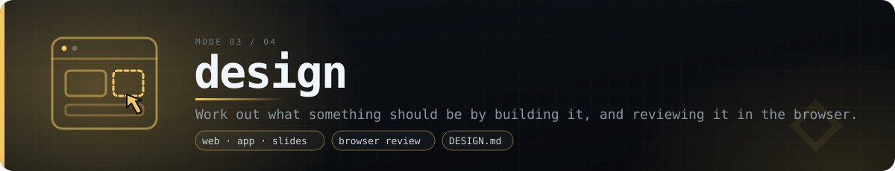
<p><strong>Design</strong> creates a prototype for you to review before changing product code.</p>
</td>
<td width="50%">
<a id="question"></a>
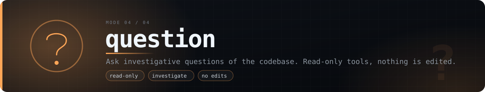
<p><strong>Question</strong> investigates the codebase using read-only tools.</p>
</td>
</tr>
</table>

In the TUI, `Tab` cycles modes and `Shift+Tab` goes back. [Mode details](docs/agent-features.md#modes).

---

## Features

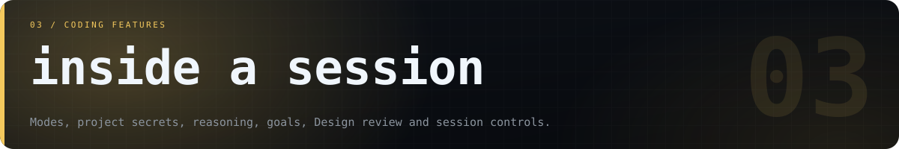

Expand a feature to learn where it runs and how to use it.

<a id="vault"></a>
<a id="secrets-and-safeguards"></a>

<details open>
<summary><strong>Vault</strong> — project secrets through references</summary>

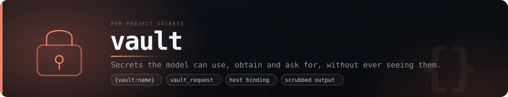

**Session engine · CLI/TUI management.** The model uses references such as `{vault:github-token}`;
tools resolve the value when needed and redact known secrets from output. Secrets belong to the project.
Use `/vault` or `redcode vault`. [Behavior and storage](docs/agent-features.md#vault).

</details>

<a id="goal"></a>
<a id="autonomy-and-monitoring"></a>

<details>
<summary><strong>Goal</strong> — keep working toward a verified outcome</summary>

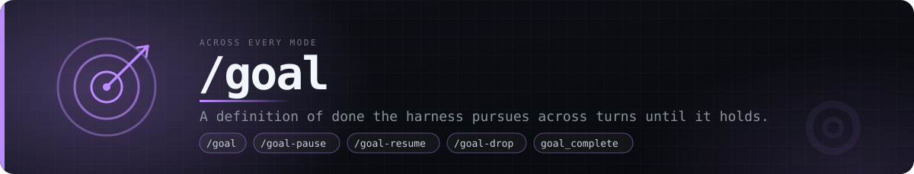

**Session engine · TUI controls.** `/goal` pursues an outcome across turns with verification gates and
stopping conditions. Pause, resume or drop it with `/goal-pause`, `/goal-resume` and `/goal-drop`.
[Goal contract](docs/agent-features.md#goal).

</details>

<a id="prototyping-and-review"></a>
<a id="design-mode"></a>
<a id="prototyping-and-integrations"></a>

<details>
<summary><strong>Prototyping and review</strong> — review a prototype beside your conversation</summary>

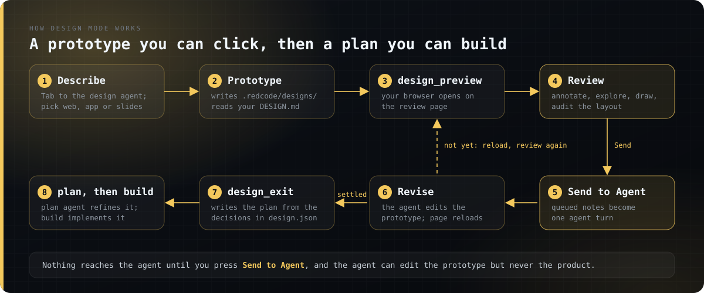

**Design mode · Desktop/browser review.** Prototype interfaces or slides using the project's design
system. Annotate elements, compare revisions and send queued feedback with **Send to Agent**.
Approval records decisions for Plan and Build.

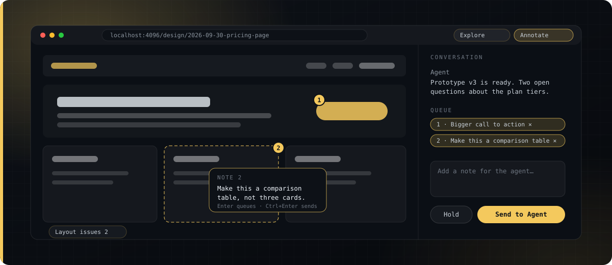

Desktop embeds the review beside the chat. Standalone browser review includes its conversation panel.
[Complete workflow](docs/agent-features.md#design-mode).

</details>

<a id="s1--s2-dual-reasoning"></a>

<details>
<summary><strong>S1 · S2 dual reasoning</strong> — optional feedback from a second model</summary>

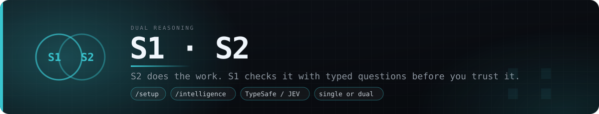

**Session engine · TUI controls.** S2 does the work; optional S1 evaluates candidates and provides feedback.
Configure with `/dual` and inspect with `/intelligence`. Coding studies have not demonstrated an accuracy
or speed gain. [Roles](docs/system-one.md) · [Measurements](docs/evaluations/reasoning-0.71.3-2026-10-02.md).

</details>

<a id="monitors"></a>

<details>
<summary><strong>Monitors</strong> — watch files, processes and HTTP endpoints</summary>

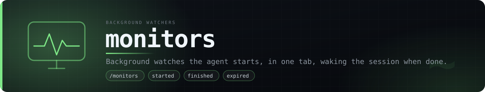

**Session engine · TUI controls.** Observes HTTP endpoints, files or processes while the session works.
Completion can wake the agent while respecting newer instructions and paused goals. `/monitors` shows
the observations. [Monitor behavior](docs/agent-features.md#monitors).

</details>

<a id="compaction"></a>
<a id="context-and-sessions"></a>

<details>
<summary><strong>Compaction</strong> — retain key decisions as context grows</summary>

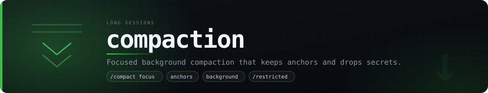

**Session engine.** TUI `/compact` accepts a focus and retains important messages and decisions.
Summaries use the vault's redaction; `/restricted` manages restricted content.
Git sessions also retain the active worktree's branch and changed-file counts; outside Git, nothing is added.
Summary compaction can use a separately configured model; an explicit S2 transformations model takes priority.
[Compaction details](docs/agent-features.md#compaction).

</details>

<a id="worktrees-and-the-background-service"></a>

<details>
<summary><strong>Worktrees and the background service</strong> — separate checkouts and retain sessions</summary>

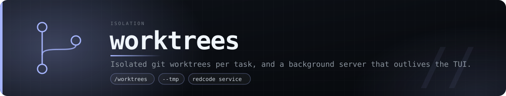

**CLI/TUI · agent server.** `redcode --tmp` starts in a temporary Git worktree; `/worktrees` or
`redcode worktrees` manages checkouts. The background server retains sessions when the terminal closes.
Inspect it with `redcode service`. [Worktrees and service](docs/agent-features.md#worktrees-and-the-background-service).

Agents can also create, list and remove worktrees through their tools, subject to permissions.
Subagent completion and cancellation remain tracked when the server unloads a project's runtime.

Histories from OpenCode, Claude Code, Codex, Pi and oh-my-pi can be imported through Desktop or CLI.
Import preserves the source history. [Import commands](docs/clients.md#desktop).

</details>

<a id="stop-loss-and-loop-guard"></a>

<details>
<summary><strong>Stop-loss and loop guard</strong> — detect loops and spending without progress</summary>

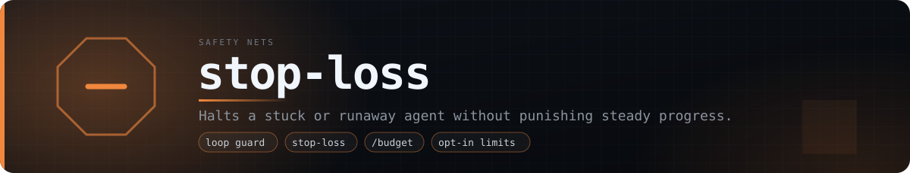

**Session engine.** Detects repeated tool results and spending without progress. TUI `/budget` adds an
optional spend/token limit; no cost limit is imposed by default. [Session guards](docs/agent-features.md#stop-loss-and-loop-guard).

</details>

<a id="redrouter"></a>

<details>
<summary><strong>RedRouter</strong> — connect an optional model gateway</summary>

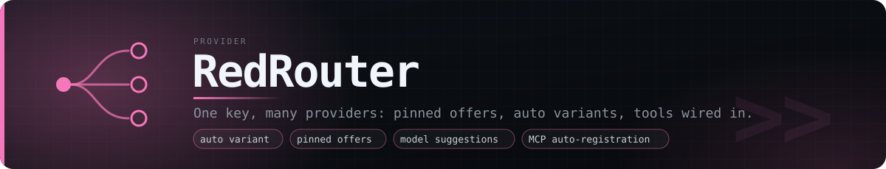

**Optional model provider · agent server.** Offers a key-scoped model catalog, automatic routing,
pinned offers and MCP tools. TUI `/connect` manages provider connections; `/dual` selects S2 and optional S1.
[Provider behavior](docs/agent-features.md#redrouter).

</details>

<a id="local-redskills-fleet"></a>

<details>
<summary><strong>Local RedSkills fleet</strong> — integrate the external redskilled daemon</summary>

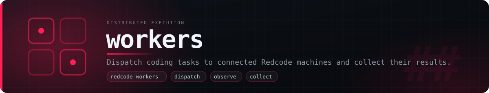

**Optional `redskilled` integration · TUI/Desktop.** Shows that daemon's project workers and fleet controls.
TUI `/workers` and the Desktop Workers tab refer to RedSkills; **Agents → Remote workers** manages the
separate [Redcode worker pool](#add-workers-to-the-coordinator). [Integration details](docs/agent-features.md#local-redskills-fleet).

</details>

<a id="dictation"></a>

<details>
<summary><strong>Dictation</strong> — voice input for the TUI composer</summary>

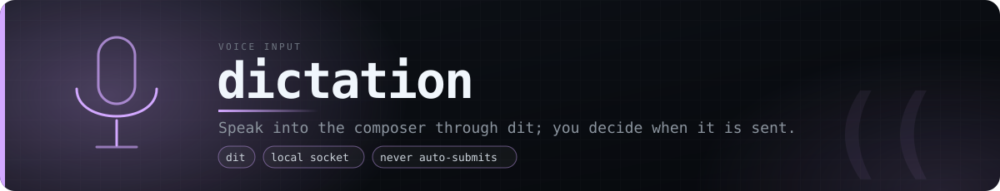

**TUI · optional dit integration.** Structured dictation stays as an editable draft and never submits
the composer. Unix uses a local socket; Windows retains dit's existing input injection.
[Voice input](docs/voice-input.md).

</details>

<a id="remote-execution"></a>

## Infrastructure

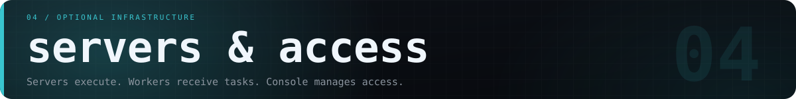

Use these options for remote coding, distributed tasks or shared access.
For local terminal use, Redcode manages the agent server in the background automatically.

Desktop, CLI and browser are clients: they display conversations and let you control execution.
The **agent server** owns the sessions, project files, tools and provider connections on its machine.
That same server becomes a **coordinator** when you register workers with it. It can run your coding
session locally and dispatch independent batch tasks to registered checkouts on itself or other machines.
**Console** manages identities and access to these resources.

<a id="components"></a>

| Component        | Purpose                                                                       |
| ---------------- | ----------------------------------------------------------------------------- |
| **Clients**      | Desktop, CLI and browser connect to the machine where you want work to run.     |
| **Agent server** | Runs the agent and tools, and owns sessions and project files on its machine.  |
| **Coordinator**  | An agent server that dispatches batches to its registered worker checkouts.    |
| **Workers**      | Agent servers that execute assigned tasks in their own checkouts.             |
| **Console**      | Administers accounts, organizations, authentication and resource access.      |

### Agent server

Your conversation executes on the server you connect to. To run an explicit server:

```sh
redcode serve --hostname 127.0.0.1 --port 4096
```

For a headless host, choose a `redcode-server-<target>` archive from [Releases](https://github.com/reddb-io/redcode/releases).
To access the CLI's managed background server from another device, run `redcode pair --remote`
on its host and open the one-time link.
First-time remote pairing lets you choose a self-hosted relay or the external hosted OpenTunnel
service. A configured relay is remembered by `redcode pair`; use
`redcode pair --remote --relay https://relay.example.org` for your own OpenTunnel-compatible endpoint.
The first remote setup asks you to accept trusted access to the host; headless setup requires `--yes`.
[Remote access setup](docs/remote-access.md).

### Remote coding over LAN or VPN

A laptop can control a stronger PC at home, which executes work itself or coordinates additional
workers. For offsite access, the connection follows this path:

**Your client → router VPN → agent server/coordinator → execution there or on its workers.**

1. Connect your router VPN so the PC's address and SSH service are reachable. On the same LAN,
   connect directly. The execution host must already have SSH available.
2. In Desktop, open **Agents → Machines → Add server → Add SSH server**. Enter the host or SSH
   alias, such as `user@10.0.0.50`. Complete authentication in the dialog; Desktop manages server
   setup and forwarding.
3. Choose a remote project or **Browse this machine**, then **Code in this project on this machine**.
   Your conversation and tools execute on that PC.
4. Choose **Manage workers on this machine** to control its pool. In **Agents → Remote workers**,
   register reachable workers and send a batch. To include execution on the coordinator in a batch,
   register an independent checkout on that machine as a worker too.

Worker addresses must be reachable **from the coordinator**. A tunnel on your laptop only connects
your client to the server; the server does not yet manage its own SSH tunnels to workers. Keep
Desktop running while its SSH forward is in use. Closing the client leaves remote sessions and the
coordinator running. Each machine owns its checkout; changes return as patches for review rather
than automatic repository synchronization.
[Remote connection guide](docs/remote-access.md#connect-desktop-over-your-lan-or-router-vpn).

<a id="add-workers-to-the-coordinator"></a>

### Workers

A **coordinator** is an agent server with registered workers. Workers run the same `redcode serve`
command, each with its own checkout and model configuration.

In Desktop connected to the coordinator:

1. Open **Agents → Remote workers**, register a worker and check the connection.
   Tasks can require capability tags and CPU/RAM budgets. Unsatisfied requirements keep the task queued with a reason; native harness controls let you steer, queue instructions or interrupt assigned work.
2. Add independent tasks and send a batch.
3. Collect and review the resulting patches.

[Worker setup and commands](docs/distributed-workers.md) · [Raspberry Pi prerequisites](docs/distributed-workers.md#raspberry-pi-prerequisites) · [Docker lab](docs/distributed-workers.md#docker-acceptance-lab)

<details>
<summary>See the architecture and current worker boundaries</summary>

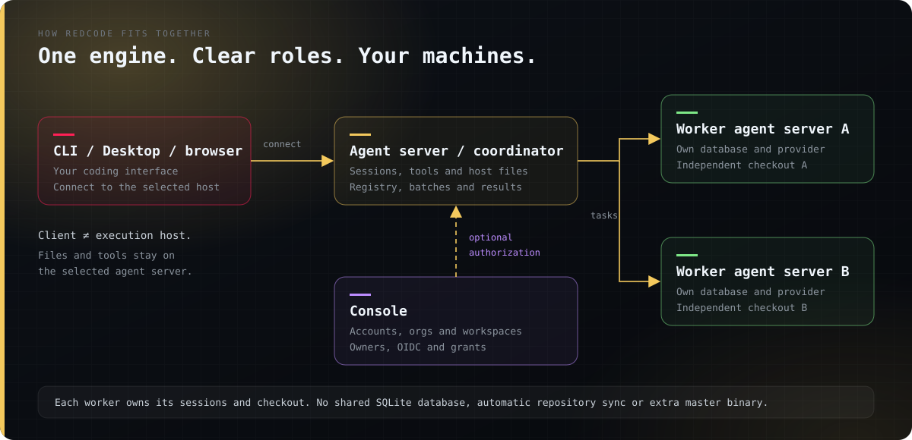

Each checkout is one execution slot. Different slots run concurrently; tasks within one slot run sequentially.
The coordinator continues when Desktop closes and accepts one unfinished batch at a time.
Checkouts are not synchronized automatically; ambiguous tasks recover on the original worker.
Physical Raspberry Pi ARM64 execution still needs device acceptance.

The CLI worker registry, permanent coordinator pool and Console resource inventory are separate.
The `redskilled` integration and Cloudflare `workerd` profile are also separate from Redcode's worker pool.
See the [worker guide](docs/distributed-workers.md) for setup, credentials and recovery.

Pairing grants trusted host access; enabling the HTTPS tunnel can restart the managed service.
See [remote access](docs/remote-access.md) for pairing and SSH setup.

Configure numeric execution reports in **Desktop → Settings → Usage reporting** for each coding server.
Signed webhooks and RedDB queues receive tokens, cache, S1/S2 usage, durations and session counters;
conversation content is excluded. [Usage reporting](docs/clients.md#usage-reporting).

</details>

### Console

The administration UI is a separate process from the coding server:

```sh
redcode console serve --port 35556
```

Open `http://127.0.0.1:35556`. First-run onboarding asks for the setup code printed in your terminal.
Use Console to manage infrastructure owners, organizations, workspace access and OIDC providers.

[Ownership and permissions](docs/console-infrastructure.md) · [Organization, owner and global authentication](docs/console-federation.md)

<details>
<summary>Console access scopes and implementation status</summary>

Infrastructure administrators manage servers, workers and resource grants. Organization owners/admins
manage their members and workspaces; organization roles do not grant infrastructure authority.
Console resource registration does not add workers to the coordinator's pool.

Configure a compatible OIDC provider in onboarding or settings: global, infrastructure-owner or
organization-specific. Login redirects to the selected provider; membership still follows invitation
and identity-linking rules. Local use requires no domain.

Delegated batches and dedicated container workspaces are supported. Prepare public Git checkouts,
set enforced resource limits and register isolated workers through **Agents → Isolated workspaces**.
Tenant-scoped interactive terminals, virtual machine isolation and full hosted SaaS services remain
incomplete. [Worker setup and isolation](docs/distributed-workers.md) · [Implementation status](docs/opencode-parity-ledger.json).

</details>

<a id="guides"></a>

## Documentation

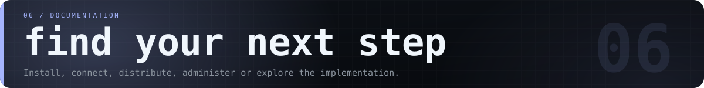

| Task                                          | Guide                                                                                                                                          |
| --------------------------------------------- | ---------------------------------------------------------------------------------------------------------------------------------------------- |
| Install Desktop, CLI or a headless host       | [Installation](docs/installation.md)                                                                                                           |
| Use commands or import conversation histories | [Clients](docs/clients.md)                                                                                                                     |
| Learn modes, Design and session features      | [Agent features](docs/agent-features.md)                                                                                                       |
| Connect from another computer                 | [Remote access](docs/remote-access.md)                                                                                                         |
| Add workers and collect their changes         | [Distributed workers](docs/distributed-workers.md)                                                                                             |
| Manage resource ownership and access          | [Console infrastructure](docs/console-infrastructure.md)                                                                                       |
| Configure authentication                      | [Console federation](docs/console-federation.md)                                                                                               |
| Follow OpenCode adoption and remaining work   | [Adopted changes](docs/upstream-adoption.md) · [Migration notes](docs/migration-parity.md) · [Parity ledger](docs/opencode-parity-ledger.json) |

<a id="contributing"></a>

<details>
<summary>Contributing, development and releases</summary>

| Repository area           | Packages                                                   |
| ------------------------- | ---------------------------------------------------------- |
| **Agent runtime and API** | `core`, `server`, `protocol`, `schema`, `client`           |
| **Clients and Design**    | `cli`, `tui`, `app`, `desktop`, `design-app`, `session-ui` |
| **Distribution**          | `redcode`, `rpc-sidecar`                                   |

Internal `@opencode/*` names preserve the upstream architecture; development happens on `main`.
Use the Bun version in `package.json`, run `bun install`, then `bun run check`. Run tests from package
directories. Public API changes require `bun run generate` in `packages/client`.

SVG artwork comes from `bun script/readme/banners.ts`; edit the generator. Releases use Changesets
and the [Redcode workflow](https://github.com/reddb-io/redcode/actions/workflows/redcode.yml).
[Build and publishing guide](docs/ci-cd.md) · [Screenshot maintenance](docs/screenshots/README.md).

</details>

Redcode builds on [OpenCode](https://github.com/anomalyco/opencode). Licensed under MIT.
See [LICENSE](LICENSE) and [NOTICE](NOTICE).
