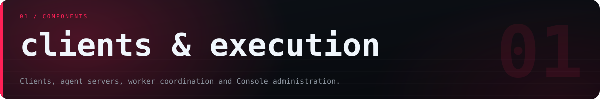
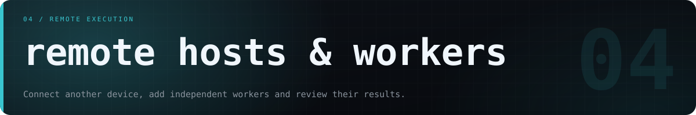
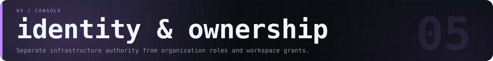
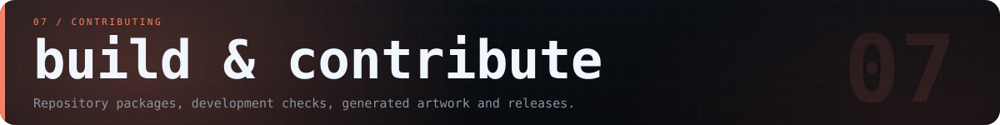

<div align="center">


<p>
  <a href="https://www.npmjs.com/package/@reddb-io/redcode"></a>
  <a href="https://github.com/reddb-io/redcode/actions/workflows/redcode.yml"></a>
  <a href="LICENSE"></a>
</p>

<strong>An open-source coding agent for your own machines.</strong><br>
Use the terminal or Desktop, design alongside your conversation, and distribute tasks to remote hosts.

</div>

---

**Explore:** [Components](#components) · [Get started](#get-started) · [Features](#features)<br>
**Operate:** [Remote execution](#remote-execution) · [Console](#console)<br>
**Go deeper:** [Guides](#guides) · [Contributing](#contributing)

Redcode builds on [OpenCode](https://github.com/anomalyco/opencode), adding project secrets,
S1/S2 reasoning, goals, Design review and infrastructure/worker administration.
Upstream attribution is preserved in [NOTICE](NOTICE).

## Components



The client is where you interact. The agent server owns execution. A worker is another execution host.
Console manages identity and access. These responsibilities stay separate even when they run on one PC.

| Layer | Component | Responsibility |
| --- | --- | --- |
| **Clients** | CLI / TUI | Terminal commands and interactive conversations. |
| **Clients** | Desktop / browser | Visual workspace, conversations, Design review and server connections. |
| **Execution** | Agent server | Sessions, providers, tools, terminals and files on its host. The CLI's background service runs this same server. |
| **Execution** | Worker coordinator | An agent server that registers workers, dispatches batches and collects results. |
| **Execution** | Remote worker | An independent agent server, database, provider configuration and checkout. |
| **Administration** | Console | Accounts, organizations, workspaces, OIDC, infrastructure membership and resource grants. |
| **Session features** | Design review | Prototype and annotation UI for a coding session; rendered by a child process of the same executable. |
| **Optional integration** | RedSkills fleet | The separate `redskilled` daemon and its project worker controls. |


A coordinator and its workers use `redcode serve`; there is no separate master executable.
The coordinator tracks assignments while each worker owns its sessions and checkout.

## Get started


Choose the installation for the machine's role:

| You want… | Install | Includes |
| --- | --- | --- |
| **Desktop and terminal on a workstation** | `mise use -g github:reddb-io/redcode@latest` or a [full native archive](https://github.com/reddb-io/redcode/releases) | CLI, agent server, Console, Design, RPC sidecar and Desktop where supported. |
| **Terminal with npm** | `npm install -g @reddb-io/redcode` | CLI, agent server, Console, Design and RPC sidecar. Desktop is supplied through full archives. |
| **A coordinator or worker host** | `redcode-server-<target>` from [Releases](https://github.com/reddb-io/redcode/releases) | Same CLI/agent engine, Console, Design and sidecar, packaged without Electron. |

From your project directory, open one client:

```sh
redcode          # Terminal UI
redcode desktop  # Desktop, with a full native installation
```

In the TUI, `/connect` adds a model provider. `/dual` or `redcode setup` configures S2 and optional S1.
The normal CLI uses a persistent local background agent server. Desktop connects to the selected
local or remote agent server; that choice determines where tools and files live.

Desktop's **Agents** view groups sessions and subagents across servers/projects. Published Design
previews open beside their conversation, retaining review controls while omitting the duplicate chat.
Histories from OpenCode, Claude Code, Codex, Pi and oh-my-pi can be imported through the project menu
or CLI; import leaves the source history unchanged.

See [installation and platform support](docs/installation.md) for archives, checksums and ARM64,
and [clients and commands](docs/clients.md) for shell commands, TUI controls, imports and server ports.

## Features


### Session modes

Coding sessions use Build, Plan, Design or Question. In the TUI, `Tab` cycles agents and `Shift+Tab`
goes back. These are session modes, separate from Console roles and worker placement.

#### Build


Reads, edits, runs and delegates to subagents under the configured permissions.

#### Plan


Explores and writes the plan before implementation. `plan_exit` asks whether to switch to Build.

#### Design


Works on an interactive prototype while keeping product code separate. The review and
approved decisions feed the plan. See [Design mode](#design-mode).

#### Question


Investigates the codebase with read-only tools. [Mode details](docs/agent-features.md#modes).

### Vault


The model works with references such as `{vault:github-token}`. The harness resolves values when a
tool needs them and redacts known secrets from output. Secrets stay scoped to the project; worktrees
share its `.env`. Use `/vault`, `redcode vault set NAME` or `redcode vault import other.env`.
[Vault behavior](docs/agent-features.md#vault).

### S1 · S2 dual reasoning


S2 does the agent work; optional S1 evaluations check candidates and provide feedback. `/dual` configures
the models, `/intelligence` shows evaluations, and `/reasoning` changes the session mode. An unavailable
or inconclusive evaluation is shown as such. Coding studies have not demonstrated an accuracy or speed
gain; keep the [measurements and limitations](docs/evaluations/reasoning-0.71.3-2026-10-02.md) alongside
the [reasoning roles](docs/system-one.md) and [full explanation](docs/agent-features.md#s1--s2-dual-reasoning).

### Goal


`/goal` keeps a session working across turns toward a defined outcome. Add verification gates,
constraints and stopping conditions; use `/goal-pause`, `/goal-resume` and `/goal-drop` to control it.
The harness checks completion instead of relying only on the agent's claim.
[Goal contract and examples](docs/agent-features.md#goal).

### Design mode


Prototype a web interface, an app or presentation slides. The agent reads `DESIGN.md` or `.red/DESIGN.md`
and reuses the project's design system. Explore revisions, annotate elements, audit layout and edit
Mermaid content through the optional whiteboard. Your queued notes reach the agent when you press
**Send to Agent**; approval records decisions for Plan and Build.


Desktop embeds the review beside the chat and omits its duplicate conversation panel. The standalone
browser review keeps that panel. Both use the same Design session, revisions and feedback. The renderer
runs as a child process of the same executable. [Complete Design workflow](docs/agent-features.md#design-mode).

### RedRouter


RedRouter exposes models through a key-scoped catalog, with automatic routing, pinned offers and MCP
tools. `/connect` also manages multiple connections for other supported providers; select S2 and
optional S1 through `/dual`. [Provider behavior](docs/agent-features.md#redrouter).

### Monitors


Monitors observe HTTP endpoints, files or processes while the session works. `/monitors` shows their
state; completion can wake the session while respecting newer instructions and paused goals.
[Monitor behavior](docs/agent-features.md#monitors).

### Local RedSkills fleet


The optional `redskilled` integration shows project worker activity and controls such as drain, stop
and status. Its daemon owns that fleet. TUI `/workers` and the Desktop Workers tab refer to this
integration; **Agents → Remote workers** manages the separate [distributed Redcode pool](#remote-execution).
[RedSkills integration](docs/agent-features.md#local-redskills-fleet).

### Stop-loss and loop guard


The loop guard detects repeated calls with the same result; stop-loss detects spending without
progress. There are no default cost limits. `/budget` adds a spend/token limit when requested.
[Session guards](docs/agent-features.md#stop-loss-and-loop-guard).

### Compaction


`/compact` accepts a focus and retains important user messages and decisions. Summaries pass through
the vault's redaction; `/restricted` manages content marked as restricted.
[Compaction details](docs/agent-features.md#compaction).

### Worktrees and the background service


`redcode --tmp` uses a temporary Git worktree. `/worktrees` or `redcode worktrees` manages project
checkouts. The background agent server retains sessions when the terminal closes; inspect and control
it with `redcode service`. [Worktree and service behavior](docs/agent-features.md#worktrees-and-the-background-service).

### Dictation


The composer accepts structured dictation from [dit](https://github.com/reddb-io/dit). Partial text is
replaceable and completed dictation stays as an editable draft; voice input never submits it.
[Voice input](docs/voice-input.md).

The [feature guide](docs/agent-features.md) retains the detailed contracts and evaluation evidence.

## Remote execution



**Code on another machine.** On the host with your projects, run:

```sh
redcode pair --remote
```

This enables the background service's HTTPS tunnel and prints expiring one-time links. Open a link
on the other device. Enabling the tunnel can restart the service. Files and execution stay on the host;
pairing is trusted host access. [SSH, foreground-server and pairing recipes](docs/remote-access.md).

**Add workers to the coordinator.** Prepare each worker with a matching Redcode version,
an independent checkout and a configured model provider. On a Linux worker:

```sh
cd /home/worker/project
export REDCODE_PASSWORD='replace-with-a-private-worker-password'
redcode serve --hostname 0.0.0.0 --port 4096
```

Then, in Desktop connected to the **coordinator**:

1. Open **Agents → Remote workers**. Register the reachable address, absolute checkout path, password/pairing token and optional tags. Use **Check connection**.
2. Add independent tasks, choose workers or allow placement on available slots, then **Send batch**.
3. Use **Review changes** to collect finished patches. Review them before applying them to your project.

One checkout is one execution slot: independent slots run concurrently, while tasks in the same slot
run sequentially. The permanent coordinator accepts one unfinished batch at a time and continues
when Desktop closes. Permission/input requests are answered through a normal client on the worker.

**Automate from the CLI.** `redcode workers add` registers a checkout in a CLI registry file;
`run`, `recover` and `collect` dispatch, observe/recover and export results. This registry is separate
from the permanent server-owned pool. The [worker guide](docs/distributed-workers.md) includes the
commands, task manifest, credentials, restart recovery, Raspberry Pi prerequisites and Docker lab.

Current boundaries: worker checkouts are not synchronized automatically; ambiguous tasks recover on
the original worker rather than failing over. Physical Pi ARM64/LAN/SSH execution still needs device
acceptance. The source's `workerd` profile targets Cloudflare Durable Objects and is separate from this pool.

## Console



Run administration separately from the coding server:

```sh
redcode console serve --port 35556
```

Open `http://127.0.0.1:35556`. On first run, enter the **setup code printed in the terminal** and create
the initial account. It receives independent organization-owner and infrastructure-admin memberships.
Console works locally without a domain; remote access uses an HTTPS reverse proxy or tunnel.

The siderail separates **Infrastructure**, **Organization**, **Workspace** and **Account**.

| Scope | Authority |
| --- | --- |
| **Infrastructure admin** | Owns server/worker administration, infrastructure membership and resource grants. |
| **Infrastructure user** | Submits/reviews their tasks on the owner's allowed resources. |
| **Organization owner / admin** | Manages organization membership and workspaces; host infrastructure authority is separate. |
| **Organization member** | Submits/reviews their own tasks within an authorized workspace. |

An infrastructure administrator registers server resources and grants eligible worker checkouts to
workspaces. This registration does not automatically add workers to the coordinator's pool.
See [resource binding and access delegation](docs/console-infrastructure.md).

**Authentication is configured through onboarding or settings**, using your own compatible OIDC provider:

| Settings scope | Purpose |
| --- | --- |
| **Infrastructure → Global authentication** | Shared providers available across organizations. |
| **Infrastructure → Owner authentication** | Providers for infrastructure access. |
| **Organization → Authentication settings** | Providers specific to that organization. |

Console discovers the issuer's endpoints and shows the callback URL. Sign-in redirects to the selected
IdP; invitations and identity-linking rules still determine membership. A shared provider does not
automatically grant organization or infrastructure authority. [OIDC setup and login behavior](docs/console-federation.md).

Delegated worker batches are supported through a Console-bound agent server. Tenant-isolated interactive
terminals, OS sandboxing and full hosted SaaS services remain incomplete. Implementation status is tracked
in the [parity ledger](docs/opencode-parity-ledger.json).

## Guides


| I want to… | Guide |
| --- | --- |
| Choose npm, Desktop or server archives | [Installation and platform support](docs/installation.md) |
| Use CLI/Desktop, import histories or start an agent server | [Clients and commands](docs/clients.md) |
| Understand modes, Design and session controls | [Agent features](docs/agent-features.md) |
| Connect from another computer | [Remote access](docs/remote-access.md) |
| Add workers, dispatch tasks, recover and collect patches | [Distributed workers](docs/distributed-workers.md) |
| Prepare Raspberry Pi workers or simulate them | [Pi prerequisites](docs/distributed-workers.md#raspberry-pi-prerequisites), [Docker acceptance lab](docs/distributed-workers.md#docker-acceptance-lab) |
| Delegate owner or organization access to resources | [Infrastructure access](docs/console-infrastructure.md) |
| Configure shared, owner or organization OIDC | [Console federation](docs/console-federation.md) |
| Inspect reasoning behavior and evidence | [S1/S2 roles](docs/system-one.md), [measurements and limitations](docs/evaluations/reasoning-0.71.3-2026-10-02.md) |
| Use dictation | [Voice input](docs/voice-input.md) |
| Track OpenCode adoption and unfinished features | [Migration notes](docs/migration-parity.md), [parity ledger](docs/opencode-parity-ledger.json) |

## Contributing



| Repository area | Packages |
| --- | --- |
| **Agent runtime and API** | `core`, `server`, `protocol`, `schema`, `client` |
| **Clients and Design** | `cli`, `tui`, `app`, `desktop`, `design-app`, `session-ui` |
| **Product distribution** | `redcode`, `rpc-sidecar` |

Internal `@opencode/*` package names preserve the upstream architecture. `main` is the development branch.
Use the Bun version in `package.json`, run `bun install`, then `bun run check` for lint and type checking.
Tests run from package directories, never the repository root. Regenerate the client with
`bun run generate` in `packages/client` after public API changes.

README artwork is generated with `bun script/readme/banners.ts`: hero, architecture, section headers
and feature SVGs. Edit the generator rather than generated artwork.

Releases use Changesets and the [Redcode workflow](https://github.com/reddb-io/redcode/actions/workflows/redcode.yml)
on `main`. Full archives include Desktop; server archives and npm keep the same CLI/Design engine
without Electron. [Build, validation and publishing procedures](docs/ci-cd.md).

Licensed under MIT. See [LICENSE](LICENSE) and [NOTICE](NOTICE).
