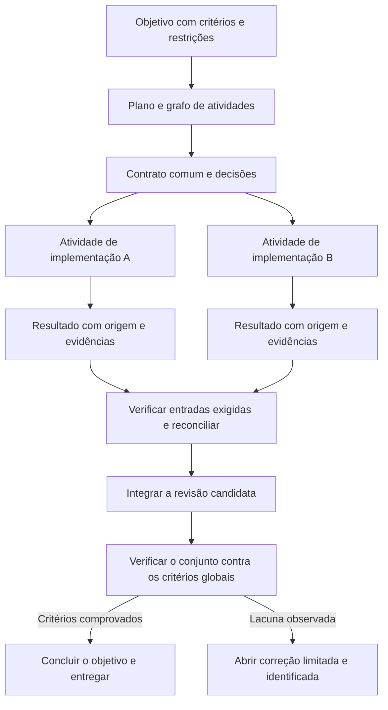

# OpenBot e a orquestração de agentes no Redcode

Consulta em 22 de outubro de 2026, America/Sao_Paulo; 23 de outubro em UTC.

O maior ganho para o Redcode é conectar objetivo, plano, delegações, dependências,
evidências e integração numa execução acompanhável. O OpenBot oferece boas
referências para essa experiência: canais com um responsável, contexto compartilhado,
delegação explícita e convergência de resultados. O Redcode já possui várias das
garantias necessárias para verificar o trabalho; elas precisam participar do mesmo
fluxo, sob os contratos, a persistência e os serviços do próprio Redcode.

## Revisões e alcance

| Projeto | Revisão consultada | Alcance |
| --- | --- | --- |
| OpenBot | `99e6ac5c61e2ceba1f20f64759cb5d72fe1aacb1` | Documentação, contratos, serviços, ferramentas, superfícies e scripts de verificação |
| Redcode | `d058b34b2aa2f0b1d6c95411b5cacdbd996c4745` | Objetivos, tarefas, subagentes, orçamento, workers, harnesses, revisão e ferramentas |

A última release pública consultada do OpenBot foi [v0.48.1][ob-release], publicada
em 22 de outubro. O commit de `main` estudado está cinco commits à frente da
release: foco do composer, atualização Nix, gestão de acesso por papel, suporte
de voz no Linux e descoberta de ferramentas para rotinas estão nessa diferença.
Presença no código desse snapshot não prova disponibilidade em todos os binários
publicados. [ob-release-diff]

Este é um estudo estático de produto e arquitetura. Os apps, provedores, integrações
e scripts do OpenBot não foram executados; a existência de um teste não foi tratada
como um resultado de teste desta análise. A proposta de implementação usa somente
as entidades e os serviços do Redcode, com o OpenBot como referência de produto.

## O que o OpenBot resolve no problema central

### Um responsável por solicitação e delegação explícita

Um canal possui instruções comuns, participantes e um agente líder. O roteamento
tenta primeiro resolver destinatário, resposta e continuação de forma determinística.
Quando precisa de modelo, usa uma sessão de roteamento sem ferramentas de trabalho,
com saída validada. Uma mensagem não dispara automaticamente todos os agentes.

`channel_assign` cria uma parte do trabalho e mantém o responsável pela solicitação.
`channel_transfer` transfere a responsabilidade. O contrato da delegação inclui
tarefa, resultado esperado, mensagens de origem, dependências e recursos declarados.
O proprietário deve integrar as respostas e responder ao usuário. O limite observado
é oito delegações automáticas por solicitação raiz e duas atribuições ativas por
canal. Não são limites universais de todos os modos de execução. [ob-channels]
[ob-channel-tools] [ob-channel-contract] [ob-channel-service]

### Contexto comum com origem e revisão

O canal mantém histórico canônico, tarefas, atribuições, resumos e posições de
leitura em SQLite. Cada par canal/agente tem uma execução separada da conversa
pessoal daquele agente. O pacote enviado inclui instruções do canal, tarefa,
resultados das dependências, memórias, resumo versionado e mensagens referenciadas.
O histórico completo continua recuperável.

Esse pacote é reconstruído de forma autossuficiente, para que troca de provedor ou
compactação não remova as decisões compartilhadas. Revisões impedem que uma
atribuição antiga conclua uma solicitação corrigida. O contexto destinado a outro
modelo exclui o raciocínio interno do membro; transparência operacional não exige
retransmitir raciocínio privado. [ob-history] [ob-channel-service]

### Convergência de respostas

Nos canais, um proprietário que abriu subtarefas fica aguardando e volta à fila
quando as dependências terminam. Nas mensagens diretas, respostas de uma solicitação
enviada a vários colegas podem ser agrupadas antes de acordar o solicitante; uma
nova mensagem humana tem prioridade. O modelo recebe também a indicação dos
colegas cujo trabalho terminou sem resposta. Isso evita sínteses sucessivas para
cada resposta individual. [ob-channel-service] [ob-agents] [ob-mailbox]

Há também um mecanismo diferente: os **routine flows**. São grafos acíclicos que
passam a saída de uma rotina para outros agentes. Um nó com várias entradas espera
todas terminarem e recebe as entradas bem-sucedidas numa mensagem. Quando todas
falham ou são puladas, ele é pulado; uma entrada com falha e outra bem-sucedida
permitem continuar. Essa política de resultado parcial precisa ser explícita para
uma entrega que exija todas as partes. [ob-flows] [ob-flow-graph]

### Controle sem abandonar trabalho ambíguo

Stop, Resume e Reassign atuam sobre tarefas e descendentes. Reatribuição aguarda
a interrupção anterior. IDs de comando, atribuição e resultado evitam despachos
e mensagens visíveis duplicados; efeitos externos não têm garantia de execução
exatamente uma vez. Recuperação consulta trabalho aceito antes de decidir repetir.
O escalonamento também serializa recursos declarados, como navegador e diretórios
que se sobrepõem. Essas reservas são coordenação, não isolamento de processos.
[ob-channels] [ob-channel-service]

## Onde o modelo do OpenBot não basta para nós

1. **Resultado esperado é principalmente texto.** `channel_result` publica texto;
   a conclusão da atribuição e a retomada do pai seguem o estado da execução.
   Nesses caminhos não há um aceite de produto equivalente a comprovar cada
   critério com testes e artefatos atuais. Reunir respostas não resolve a
   validação semântica ou a integração de código. [ob-channel-tools]
   [ob-channel-service]
2. **Os grafos de rotina usam agente como nó.** Há uma etapa por agente e execução,
   e uma ligação de volta ao proprietário da rotina é recusada. Isso limita
   pipelines que precisam usar o mesmo especialista em mais de uma etapa.
   Nosso grafo deve identificar atividades; uma identidade de agente pode executar
   atividades diferentes. [ob-flow-schema] [ob-flow-graph]
3. **A configuração do fluxo não é uma revisão imutável completa.** A execução
   filtra as ligações atuais pela data de criação. Isso impede acrescentar uma
   nova ligação a um run antigo, mas não constitui um snapshot de todas as
   instruções e ligações daquela execução. O Redcode deve fixar uma revisão do
   plano e dos insumos que cada resultado aceita. [ob-flows]
4. **Tarefas do mesmo agente compartilham workspace.** A documentação diz
   explicitamente que essas tarefas não possuem trava de arquivos. Threads
   diferentes não tornam edições concorrentes independentes. Para escrita, nossa
   política precisa escolher isolamento ou serialização de escopos conflitantes.
   [ob-agents]
5. **Participantes do canal não são uma ACL de pessoas.** Todo membro autenticado
   do servidor pode usar seus canais. Não devemos importar essa regra para
   contextos com autorização por organização/projeto/tarefa. [ob-channels]
6. **A maturidade varia por superfície e provedor.** Existem capacidades opcionais,
   diferenças entre desktop/web/mobile, operações locais e limites de protocolos.
   Os scripts de canal exercitam cenários com provedores reais, mas não foram
   executados neste estudo. [ob-team] [ob-web] [ob-channel-check]
7. **O README não é suficiente para avaliar permissões.** Seu aviso geral de acesso
   completo convive com código e documentação mais recentes para Workspace only,
   Ask first, Full access, confinamento por provedor e aprovações interativas.
   Esses limites precisam ser lidos nos contratos e implementações atuais.
   [ob-structure] [ob-sandbox]

## O que já temos no Redcode

| Base existente | Evidência atual | Lacuna que permanece |
| --- | --- | --- |
| Objetivo com critérios, gates, revisão e conclusão verificada | `SessionGoal`; conclusão lê e verifica arquivos, executa gates e verifica trabalho pendente | Associar explicitamente cada atividade e contribuição ao mesmo objetivo |
| Objetivo compartilhado com subagentes | `SessionGoal.inherit` transmite objetivo e critérios; apenas o pai conclui | Transformar essa herança em relação visível entre objetivo, tarefa e resultado |
| Brief estruturado e revisão de subagente | `scope`, `done_criteria`, `return_format`; verificações mecânicas, revisão S1 em dual e uma rodada de reparo | Amarrar o resultado revisado à atividade canônica e à reconciliação de todas as partes |
| Tarefas com origem e evidências | `SessionTodo` liga requisito, critério e resultado de ferramenta; edições posteriores podem invalidar a prova | Dependências e atribuições entre tarefas/sessões/workers como contrato de execução |
| Orçamento da árvore local de sessões | `SessionBudget` soma descendentes e avaliações e consulta limites dos ancestrais | Um objetivo distribuído não tem esse orçamento agregado automaticamente entre servidores e harnesses |
| Execução durável e retomada do pai | Inbox persistente, jobs de subagente e entrega sintética de resultados | Uma barreira de convergência para um grupo de atividades exigidas, em vez de depender só da chegada individual |
| Workers remotos e segurança de atribuição | Fila, seleção por tags, admissão por recursos, reserva de checkout, geração e recuperação no worker original | Manifesto atual é uma lista de prompts independentes, sem decomposição e dependências |
| Artefatos e revisão de Git | Coleta de diff da execução com SHA-256; integração de worktree verifica os dois commits e aceita apenas fast-forward | Coletar patch não reconcilia várias entregas; branches paralelas divergentes não são integradas automaticamente |
| Visibilidade e intervenção | Agents mostra sessões, subagentes, inbox, filas, motivos de espera, worker e controles de execução | Falta uma visão por objetivo atravessando essas superfícies; o relatório de batch não registra transições e duração |
| Navegador, Computer Use, MCP e ferramentas sob demanda | Browser plugin nativo, Agent tools e Code Mode | Melhorar descoberta e coordenação; não reconstruir essas capacidades |

Fontes: [rc-goal], [rc-goal-tool], [rc-subagent], [rc-review], [rc-todo],
[rc-todo-proof], [rc-budget], [rc-completion], [rc-workers], [rc-worker-schema],
[rc-pool], [rc-worktree], [rc-agents], [rc-browser], [rc-tools] e [rc-codemode].

S1 não é uma prova universal de correção. Em single não há a mesma revisão
semântica; resultados inconclusivos ou indisponíveis continuam assim identificados.
A proposta deve reaproveitar essas distinções, sem apresentar uma avaliação
automática como substituta de testes e revisão da integração.

## Inventário de funcionalidades e oportunidades

“Base” significa que existe uma capacidade correspondente, não paridade integral.
“Ampliar” significa que uma parte existe; “Nova superfície” indica que não foi
encontrado um equivalente nativo no recorte do Redcode. Cada oportunidade está
organizada como evolução dos contratos ou como uma nova capacidade do próprio
Redcode. A prioridade é relativa ao pedido de orquestração: P0 primeiro, P1 depois
do contrato principal, P2 expansão e P3 produto adjacente.

### Agentes e execução

| Funcionalidade no OpenBot | Situação e oportunidade para nós | Prioridade |
| --- | --- | --- |
| Colegas persistentes, perfil, instruções, avatar e organização em seções | Ampliar agentes configuráveis com identidade e responsabilidade visíveis por objetivo | P1 |
| Criar e editar agentes por conversa, ler sua configuração e preparar equipes | Ampliar composição de equipe com revisão de escopo e permissões; criação não deve ampliar autoridade | P1 |
| Codex, Claude, Grok, OpenCode, Gemini/Antigravity, Cursor, Cline, Pi, Muse e Inception, mais ACP customizado | Base nativa Redcode e dois harnesses externos; adicionar drivers só com demanda e testes de capacidade, sem confundir modelo com CLI | P2 |
| Descoberta de runtimes e endpoints locais, provedores OpenAI-compatible e registro ACP | Ampliar setup de harnesses; Redcode já tem catálogo de modelos e provedores | P2 |
| Download e atualização de CLIs gerenciados, precedência de executável e diagnósticos | Ampliar instalação explícita atual; preservar comandos do usuário e execuções ativas | P2 |
| Preferências de modelo/effort e modelos de reserva após limite de uso | Base de seleção e roteamento; avaliar backup por harness sem prometer as mesmas capacidades | P2 |
| Monitoramento de contexto, compactação e handoff ao trocar sessão/provedor | Base; melhorar apresentação e contrato de contexto comum entre atividades | P1 |
| Fila durável, edição, pausa, cancelamento, retomada e steer | Base; fazer aparecer na visão do objetivo sem criar segunda fila de mensagens | P0 |
| Tarefas paralelas por agente com conversa, fila, progresso e resultado próprios | Base em sessões filhas/workers; falta a identidade comum da atividade e seu aceite | P0 |

Fontes OpenBot: [ob-agents], [ob-providers], [ob-tasks], [ob-mailbox], [ob-structure].

### Coordenação e transparência

| Funcionalidade no OpenBot | Situação e oportunidade para nós | Prioridade |
| --- | --- | --- |
| Mensagens entre agentes, respostas correlacionadas, reações, imagens e arquivos | Ampliar retorno pai/filho com comunicação vinculada a tarefa; evitar chat irrestrito que cria novos trabalhos | P1 |
| Canal compartilhado, líder, participantes e histórico com autoria | Nova superfície por objetivo, usando o DS React e as entidades existentes | P0 |
| Roteamento determinístico e decisão limitada por modelo | Ampliar escolha de especialista por capacidade e escopo; nunca transmitir a tarefa a todos por padrão | P1 |
| Delegar uma parte versus transferir toda a responsabilidade | Contrato explícito de responsável, atividade e revisão; manter um responsável final | P0 |
| Dependências, agrupamento de respostas e retomada do responsável | Grafo de atividades e política de convergência sobre resultados aceitos | P0 |
| Stop, Resume, Reassign, arquivar e restaurar sem perder o histórico | Base de controles; ampliar para objetivo e subgrafo com estado de atribuição consistente | P1 |
| Reservas de navegador e diretórios declarados | Ampliar coordenação de recursos, reaproveitando reservas de checkout dos workers; não chamar reserva de sandbox | P1 |
| Aprovações, perguntas, tomada de controle e alertas no contexto correto | Base de inbox e permissões; agrupar por objetivo/tarefa e preservar a origem da solicitação | P0 |
| Progresso significativo, sem loops de reconhecimento entre bots | Política de comunicação com eventos verificáveis, bloqueios concretos e detalhes sob demanda | P1 |

Fontes OpenBot: [ob-channels], [ob-channel-tools], [ob-channel-contract],
[ob-channel-service], [ob-agents].

### Memória e conhecimento

| Funcionalidade no OpenBot | Situação e oportunidade para nós | Prioridade |
| --- | --- | --- |
| Memórias por agente, canal e conversa externa | Nova capacidade do Redcode, com escopo, origem, revisão e controle do usuário | P2 |
| Memórias essenciais versus pesquisáveis, busca FTS e revisões | Contexto comum limitado, com origem e mudanças explícitas; memória não deve substituir o pedido atual | P1 |
| Histórico pesquisável e leitura paginada de trechos e atividades | Base de histórico; facilitar recuperação de evidência sem injetar todos os transcripts | P1 |
| Banco compartilhado com SQL, tabelas e autoria | Nova superfície para dados de trabalho; não usar tabelas editáveis por todos como autoridade do scheduler | P2 |
| Biblioteca local de skills com revisões imutáveis e proteção de arquivos modificados | Ampliar descoberta e carregamento de skills do Redcode com biblioteca versionada e revisão das instalações | P2 |
| Plugins com MCP, skills fixadas e links de compartilhamento | Base de MCP/extensões; estudar composição e instalação. A documentação ainda marca partes do catálogo/cache como design | P2 |
| Templates de agente publicados por link e importação de agentes | Ampliar portabilidade de perfis, critérios e skills, sem copiar credenciais ou conceder permissões | P2 |
| Transferência de instância com perfis, rotinas, memórias, arquivos e parte dos ajustes | Import/export de equipe é oportunidade; não equivale a migrar sessões nativas, histórico ou segredos | P3 |

Fontes OpenBot: [ob-agents], [ob-history], [ob-memory], [ob-data], [ob-skills],
[ob-structure].

### Automação

| Funcionalidade no OpenBot | Situação e oportunidade para nós | Prioridade |
| --- | --- | --- |
| Rotinas recorrentes e únicas, timezone, calendário e feed iCalendar local | Nova capacidade de agendamento no Server, admitindo trabalho pelo inbox existente; monitores não são um calendário de rotinas | P2 |
| Webhooks com filtros, assinatura, histórico e deduplicação | Nova entrada para trabalho durável, reaproveitando admissão e autorizações | P2 |
| Canvas de routine flows com divisão e convergência | Inspiração direta para o grafo; priorizar primeiro a execução por objetivo, depois a recorrência | P1 |
| Sessão curta por rotina, digest limitado e execução silenciosa quando não há novidade | Evitar poluir contexto, notificações e custos de um agente de longa duração | P2 |
| Esperas persistidas, retomadas por evento/rotina e notas de bloqueio | Base de monitores/jobs; ampliar espera por evento de domínio sem ocupar uma execução de modelo | P1 |
| Entrega de resultado de rotina em conversas externas e recuperação de envios | Integrar como destino de uma entrega aceita, sem reenviar efeitos ambíguos | P2 |
| CLI e API local para scripts, mensagens, rotinas e respostas a solicitações | Base de APIs/CLI; expor o futuro grafo pelo mesmo contrato | P1 |

Fontes OpenBot: [ob-agents], [ob-flows], [ob-flow-graph], [ob-waits],
[ob-webhooks], [ob-routine-results], [ob-automation].

### Ferramentas e entrega de trabalho

| Funcionalidade no OpenBot | Situação e oportunidade para nós | Prioridade |
| --- | --- | --- |
| Navegador persistente, tabs, snapshots, ações, emulação, screenshots e gravação | Base nativa já ampla; coordenar posse da tab e manter relação com a tarefa | P1 |
| Takeover humano e autenticação sem expor senha ao modelo; conectores 1Password/Bitwarden | Base de Vault e permissões, mas o fluxo especializado de takeover/autofill é uma ampliação distinta | P2 |
| Computer Use e desktop remoto | Base de Computer Use opcional e acesso remoto; streaming de desktop e operação de browser são capacidades diferentes | P2 |
| Anexos gerenciados, transferência entre agentes, prévias, busca e uso de armazenamento | Base parcial; artefatos de tarefa precisam de identidade, hash, origem e disponibilidade | P0 |
| Resposta visual HTML, prévia, gráficos, formulários, plano e perguntas laterais sem ferramentas | Base de Design e formulários; estudar uma entrega visual associada à atividade, sem substituir Design | P2 |
| Integração de imagens geradas pelo provedor | Base no Design; preservar origem, limites e vínculo ao resultado | P2 |
| Publicação, substituição e remoção de sites estáticos | Produto adjacente; não é pré-requisito de orquestração | P3 |
| Voz com transcrição local/cloud e leitura local de respostas | Redcode tem ditado integrado ao TUI; STT/TTS integrado no desktop seria ampliação separada | P3 |
| Descoberta de ferramentas com catálogo compacto e schemas dos melhores resultados | Base em Code Mode; medir economia antes de mudar a descoberta atual | P1 |

Fontes OpenBot: [ob-browser], [ob-computer], [ob-skills], [ob-tools], [ob-voice],
[ob-discovery], [ob-servers]. Correspondentes Redcode: [rc-browser], [rc-tools],
[rc-voice], [rc-codemode].

### Acesso, operação e distribuição

| Funcionalidade no OpenBot | Situação e oportunidade para nós | Prioridade |
| --- | --- | --- |
| Aplicação desktop macOS/Windows/Linux e cliente web | Base existente; preservar a arquitetura cliente/servidor do Redcode | P1 |
| App nativo iOS/Android, push e Live Activity no iPhone | Redcode possui web/PWA responsivo; cliente nativo é projeto separado | P3 |
| Slack, Discord e Telegram, memória por conversa e publicações por ferramentas | Novos adapters de entrada/saída do Redcode, vinculados ao mesmo objetivo e à admissão durável | P2 |
| Conta opcional, convites, papéis, sessões e servidores compartilhados | Base de infraestrutura e autorização; conservar escopo de organização/projeto | P1 |
| WebRTC com conexão direta/relay, capacidades opcionais e compatibilidade versionada | Ampliar transportes só por necessidade; não trocar a API atual por causa da referência | P3 |
| Servidor self-hosted, Docker, ECS, Nix e hosts remotos | Base de servidores/workers/containers; separar distribuição de orquestração | P2 |
| Servidor hospedado, planos, billing, sleep/wake e quotas | Produto de infraestrutura; integrar a plataforma existente se virar demanda | P3 |
| Uso por agente/host/modelo, tokens, cache e estimativa de custo | Base de uso/orçamento; ampliar a visão para objetivo e atividade com custo desconhecido explícito | P0 |
| Recursos do host, limites, logs, diagnóstico e exportação com proteção de dados | Base parcial; ligar falha, espera e custo à atribuição, sem confundir amostragem com reserva | P1 |
| Permissões por agente, confinamento e aprovações | Base com mecanismos próprios; manter autorização na execução, não no roteador ou no prompt | P0 |
| Atualizações de app/provedores, releases e contratos de clientes antigos | Base; preservar execuções ativas e negociar capacidades reais por adapter | P1 |
| Localização, configurações, aparência e notificações por agente/host | Base; notificações do objetivo devem agregar resultados e destacar intervenção necessária | P1 |
| Site público, marketplace, status e webhooks operacionais da própria plataforma | Capacidades de distribuição/operação; os status webhooks são internos à equipe OpenBot, não uma API geral de tarefas | P3 |

Fontes OpenBot: [ob-readme], [ob-channels], [ob-messaging], [ob-team], [ob-web],
[ob-servers], [ob-hosting], [ob-analytics], [ob-structure], [ob-status].

## Proposta para objetivo comum e atividades menores

### Uma composição das entidades existentes

Usar `SessionGoal` como objetivo e contrato de conclusão; `SessionPlan` e
`SessionTodo` como plano e atividades com critérios; sessões filhas e atribuições
de worker como execuções. Harnesses externos entram por adapters explícitos das
capacidades que realmente suportam. O grafo relaciona essas identidades e revisões.
Não deve existir uma tarefa da UI, outra tarefa do scheduler e uma terceira no
histórico com donos e estados divergentes.

O objetivo comum precisa ficar legível para humanos e agentes: resultado desejado,
critérios globais, restrições, decisões vigentes, orçamento autorizado e responsável
final. Uma atividade recebe um contrato menor, com referência ao objetivo, parte do
requisito que cobre, escopo, dependências, insumos e formato de entrega.

Decompor por **entregável verificável**, não por quantidade de agentes. Evitar
atividades como “ajudar no backend”. Preferir “implementar o endpoint X segundo o
contrato Y; executar os checks Z; devolver revisão, diff e evidências”. Uma parte
pequena e sequencial não ganha um agente só para preencher o grafo. Dependências
impedem executar consumidor de um contrato ainda não definido.

O nó deve representar uma atividade, não uma pessoa/modelo. O mesmo especialista
pode receber atividades distintas de implementação e reparo. Dependências formam
um grafo sem ciclos; nova rodada de correção é uma tentativa ou atividade explícita
e limitada, mantendo o histórico de falhas.

### Responsabilidades dentro do Redcode

| Responsabilidade | Base atual | Evolução proposta |
| --- | --- | --- |
| Objetivo e conclusão | `SessionGoal` e `goal_complete` em Core | Relacionar critérios globais às atividades e verificar a entrega integrada |
| Plano e atividades | `SessionPlan` e `SessionTodo` | Acrescentar dependências, atribuição, revisão de insumos e contrato de resultado |
| Coordenação do grafo | Serviços de sessão, inbox e jobs | Regras persistentes de prontidão, convergência, correção e cancelamento, sem outro loop de modelo |
| Execução local | `SessionExecution`, `SessionRunCoordinator` e subagentes | Executar atividades pela mesma admissão durável e retornar resultados à sessão responsável |
| Execução remota | `WorkerPool` e reservas de checkout em Server | Admitir apenas atividades prontas e relacionar a atribuição à revisão do grafo |
| Harnesses externos | Serviços e contratos `Harness` em Server/Schema | Adapters de resultado e controle, mantendo explícitas as diferenças de retomada e uso |
| Verificação e integração | Revisão de subagentes, evidências de tarefas, coleta de patches e `worktree-review` | Aceite de resultados e etapa de integração de múltiplas contribuições, com nova verificação |
| Contexto comum e memória | Instruções e histórico de sessão; memória de equipe é uma nova capacidade | Decisões versionadas, consulta limitada e referências às fontes dentro do Redcode |
| Transparência e intervenção | Agents, inbox e APIs existentes | Visão por objetivo com lista/grafo, origem das evidências e controles do dono da execução |

O objetivo pertence à sessão responsável. As regras do grafo pertencem ao domínio
em Core; Server compõe os adapters de workers e harnesses, e os clientes exibem as
projeções via Protocol. Prontidão e progresso são derivados dos fatos persistidos.
Perguntas, permissões e efeitos continuam sob as políticas do runtime que os executa.
Essas são extensões propostas, não capacidades já entregues do grafo.

### Fluxo de uma entrega

Cada atividade deve registrar referências para o requisito e objetivo; revisão do
plano e do brief; responsável; execução/tentativa; dependências exigidas e opcionais;
escopo de escrita; artefatos de entrada; saída esperada; evidências e veredito.
Esses dados devem estender/referenciar os contratos existentes, não duplicar todos
os seus campos em um novo armazenamento paralelo.

Separar três dimensões: **execução** terminou ou não; **resultado** foi aceito,
rejeitado ou permanece inconclusivo; **integração** foi validada no conjunto ou
continua pendente. Uma sessão ociosa com resposta não basta para marcar o objetivo
como concluído.

### Reconciliação dos resultados

1. **Esperar o conjunto necessário.** A política diz quais entradas são obrigatórias
   e se alguma contribuição pode faltar. Falha ou silêncio de uma entrada exigida
   impede declarar a entrega completa; contribuições opcionais ausentes aparecem
   como limitação. Cancelamento não é sucesso.
2. **Validar identidade e atualidade.** Conferir tarefa, tentativa, revisão do
   brief/plano, origem, artefatos e hashes. Um resultado de uma versão antiga não
   conclui a nova. Mudança de insumo invalida os consumidores afetados e suas provas,
   preservando atividades independentes válidas.
3. **Comparar contratos e evidências.** Reaproveitar a revisão de subagentes e os
   gates do Redcode. Alegação sem prova, avaliação indisponível e escopo excedido
   continuam identificados; não ganham aceite pela redação da resposta.
4. **Reconciliar informação e código de formas adequadas.** Pesquisa produz uma
   síntese com fontes, divergências, conclusões sustentadas e lacunas. Código exige
   conferir contrato, base/revisão de Git, arquivos sobrepostos e dependências.
   Uma resposta textual não substitui o diff ou um commit.
5. **Integrar e verificar uma revisão candidata.** Coleção de patches não é merge.
   Aproveitar a revisão dos dois commits e a integração fast-forward existentes
   quando aplicáveis. Ramos paralelos divergentes exigem um caminho explícito de
   integração e conflitos, com nova verificação; essa automação ainda precisa ser
   desenhada nos serviços de integração do Redcode. O resultado deve identificar
   a revisão candidata e as contribuições incorporadas antes de ser aceito.
6. **Fechar pelo objetivo inteiro.** Executar os checks de integração, os critérios
   funcionais e a validação de runtime pertinente. Só o responsável pelo objetivo
   propõe sua conclusão. O relatório final mostra resultado integrado, evidências,
   revisões, riscos restantes e o que não foi realizado.

O resultado recebido deve ser um pacote tipado de referências e observações:
resumo, entregáveis, critérios atendidos, evidências de checks, alterações/commit,
bloqueios, limitações e decisões necessárias. Custo e uso vêm do runtime e são
associados ao pacote; não são valores aceitos da narrativa do agente.

### Transparência operacional

A visão por objetivo deve mostrar o grafo e também uma lista utilizável em telas
estreitas. Para cada atividade: o que cobre, responsável, execução/host/harness,
dependências, estado do resultado, motivo atual de espera, última observação,
artefatos, verificação e uso. A inspeção detalhada abre a sessão existente, não uma
cópia da conversa. Os controles existentes continuam no dono correto da execução.

Exibir espera por dependência, aprovação, usuário, recurso, orçamento e conexão
como causas diferentes. Observação antiga deve estar marcada como antiga. A UI
não deve apresentar progresso total apenas porque vários agentes terminaram;
contagem de execução e contagem de entregas aceitas são leituras diferentes.

Mostrar decisões, correções de escopo, atribuições, chamadas, evidências e seus
efeitos. Não depender de raciocínio interno privado para explicar a coordenação.
Atualizações comuns são agregadas; bloqueios, mudanças materiais e pedidos de
intervenção continuam visíveis. Isso dá transparência sem uma conversa cheia de
mensagens de “recebido” entre bots.

### Contexto e custo

Cada execução lê um pacote limitado: objetivo e revisão, atividade, decisões
relevantes, referências às dependências aceitas e evidências necessárias. Histórico
e artefatos grandes são recuperados sob demanda. Memórias e saídas de outros
agentes são dados com origem, não instruções com autoridade sobre o usuário.

Reutilizar orçamento da árvore local, limites de fan-out e stop-loss. Para tarefas
em servidores/harnesses independentes, a agregação e a admissão de gasto são uma
extensão distinta; soma local de descendentes não as resolve. Uso indisponível
permanece desconhecido, sem inventar custo zero ou somar snapshots cumulativos.

O commit consultado do OpenBot melhora a descoberta para devolver schemas de até
três correspondências fortes e relata redução de chamadas/tokens em um cenário
de mail. É evidência relatada pelo upstream, não economia medida no Redcode.
Já temos Code Mode com catálogo limitado e busca. Primeiro medir nosso overhead
de coordenação, tokens e custo por objetivo aceito. [ob-commit] [ob-discovery]
[rc-codemode] [rc-budget]

## Implementação recomendada em etapas

| Ordem | Entrega | Ganho e critério para fechar | Esforço relativo |
| --- | --- | --- | --- |
| 1 — P0 | Contrato que liga objetivo, tarefa, dependências, execução e resultado | Uma solicitação de três partes pode ser acompanhada até evidência de cada requisito; não há tarefa órfã ou conclusão por texto | Alto |
| 2 — P0 | Convergência e aceite dos resultados | Pai espera as entradas exigidas, recebe resultados juntos e não conclui com falha, revisão antiga ou prova invalidada | Alto |
| 3 — P0 | Integração de múltiplos resultados no Redcode | Artefatos e revisões de origem são conferidos; conflitos ficam explícitos e os checks validam uma revisão candidata do conjunto | Alto |
| 4 — P0 | Visão por objetivo no Agents, com DS React | Usuário vê responsável, atividade, espera, artefatos e resultado aceito; desktop/mobile e intervenção preservam identidade | Médio |
| 5 — P1 | Adaptar o batch nativo ao grafo | Dependências controlam admissão; leases, slots e recuperação original continuam válidos; resultado coletado não vira aceite automático | Alto |
| 6 — P1 | Decisões e contexto compartilhados com revisão | Correção do usuário alcança próximas atividades e invalida só as entradas/resultados afetados | Médio |
| 7 — P2 | Templates, memória e rotinas reutilizáveis | Equipe e workflow podem ser repetidos com novas identidades de execução e sem herdar credenciais/permissões | Médio/alto |
| 8 — P2/P3 | Mais harnesses, mensageria, app móvel, voz e hosting | Implementar conforme demanda; nenhuma dessas expansões é requisito para validar o fluxo principal | Varia |

Os esforços são comparativos, não estimativas de prazo. A via interativa de
sessões pode evoluir primeiro, sem esperar todos os adapters. Harnesses externos
continuam explicitamente separados até existir um contrato capaz de representar
suas diferenças de steer, retomada, permissões e medição.

### Limites arquiteturais da implementação

- Contratos portáveis em Schema/Protocol; domínio e regras de sessão em Core;
  composição de workers e harnesses em Server; clientes consomem Schema/Protocol.
  Core não importa Server. Regenerar o Client quando a HttpApi pública mudar.
- Persistir fatos e relações irreduzíveis. Prontidão por dependências e totais de
  progresso podem ser projeções; não registrar cópias de estados deriváveis.
- Manter `Session.prompt` e o inbox como admissão durável. A coordenação não cria
  um loop de ferramentas paralelo à execução da sessão, nem transforma o
  coordenador local em scheduler de sessões compartilhadas entre bancos.
- Server mantém a composição dos workers e harnesses do Redcode. As regras de
  prontidão do grafo não substituem a reserva de checkout, a admissão por recursos
  ou a autorização da execução. Core acessa essas capacidades por contratos,
  preservando a direção das dependências.
- Repetir observação é diferente de repetir efeito. Preservar IDs, revisões,
  credenciais no host e recuperação de resultados ambíguos. Nenhuma reserva de
  recurso deve ser apresentada como garantia de efeitos exatamente uma vez.
- Componentes da nova visão usam DS React. Nenhuma proposta desta análise exige
  copiar Solid/UI do OpenBot ou interromper a migração de renderers já em curso.

### Cenários de aceitação antes de considerar a entrega pronta

- Duas atividades independentes rodam em paralelo, uma dependente espera e o
  responsável produz uma única entrega integrada com origem de cada parte.
- Uma atividade obrigatória falha, uma opcional não responde e outra termina:
  o objetivo permanece incompleto, com política e causas legíveis.
- Usuário corrige um requisito durante a execução: resultado antigo é preservado
  no histórico, mas não satisfaz a revisão nova; trabalho independente válido não
  é refeito.
- Coordenador ou conexão cai depois de admitir um prompt: reconexão não duplica a
  tarefa nem assume que o efeito não aconteceu.
- Dois agentes propõem escrita em escopos conflitantes: há isolamento ou espera
  explícita; threads distintas não são usadas como garantia de proteção de arquivo.
- Cada parte passa isoladamente, mas a integração falha: atividades continuam
  identificadas e uma correção limitada recebe evidência do problema; objetivo
  não fica concluído.
- Orçamento do pai acaba, avaliação está indisponível ou métricas de um harness
  são desconhecidas: o estado continua explícito e não vira aprovação nem custo zero.
- Uma pessoa sem acesso ao projeto/tarefa não ganha acesso a dados só por estar no
  mesmo servidor ou na mesma interface de canal.
- O worker termina, mas falta revisão, integração ou verificação do conjunto:
  a interface mantém essas etapas pendentes e não relata o objetivo como concluído.
- Um objetivo percorre planejamento, execução local/remota, coleta, integração e
  aceite usando apenas serviços e identidades do Redcode, com rastreabilidade de
  cada critério até sua evidência.

## Licença e decisão de reaproveitamento

O snapshot atual usa **PolyForm Noncommercial 1.0.0** e o projeto declara exigir
licença comercial separada para uso comercial. Versões até 0.1.11 permanecem sob
Apache-2.0, mas isso não licencia as funcionalidades atuais sob Apache. A estratégia
recomendada é estudar os padrões de produto e implementar os contratos próprios
do Redcode. Copiar ou vendorizar código atual exige resolver o licenciamento antes.
Nenhum código do OpenBot foi incorporado por este estudo. [ob-license] [ob-readme]

## Fontes

Os links OpenBot abaixo estão fixados na revisão analisada; os links locais
identificam os donos atuais dos contratos no Redcode.

[ob-release]: https://github.com/nightly-labs/openbot/releases/tag/v0.48.1
[ob-release-diff]: https://github.com/nightly-labs/openbot/compare/v0.48.1...99e6ac5c61e2ceba1f20f64759cb5d72fe1aacb1
[ob-commit]: https://github.com/nightly-labs/openbot/commit/99e6ac5c61e2ceba1f20f64759cb5d72fe1aacb1
[ob-readme]: https://github.com/nightly-labs/openbot/blob/99e6ac5c61e2ceba1f20f64759cb5d72fe1aacb1/README.md
[ob-license]: https://github.com/nightly-labs/openbot/blob/99e6ac5c61e2ceba1f20f64759cb5d72fe1aacb1/LICENSE
[ob-channels]: https://github.com/nightly-labs/openbot/blob/99e6ac5c61e2ceba1f20f64759cb5d72fe1aacb1/docs/architecture/channels-and-messaging.md#shared-channel-chats
[ob-channel-tools]: https://github.com/nightly-labs/openbot/blob/99e6ac5c61e2ceba1f20f64759cb5d72fe1aacb1/src/backend/channel-tools.ts
[ob-channel-contract]: https://github.com/nightly-labs/openbot/blob/99e6ac5c61e2ceba1f20f64759cb5d72fe1aacb1/packages/contracts/src/ipc-chat-channels.ts
[ob-channel-service]: https://github.com/nightly-labs/openbot/blob/99e6ac5c61e2ceba1f20f64759cb5d72fe1aacb1/src/backend/channel-service.ts
[ob-history]: https://github.com/nightly-labs/openbot/blob/99e6ac5c61e2ceba1f20f64759cb5d72fe1aacb1/src/backend/channel-history.ts
[ob-agents]: https://github.com/nightly-labs/openbot/blob/99e6ac5c61e2ceba1f20f64759cb5d72fe1aacb1/docs/architecture/agents.md
[ob-flows]: https://github.com/nightly-labs/openbot/blob/99e6ac5c61e2ceba1f20f64759cb5d72fe1aacb1/src/backend/routine-flows/routine-flows.ts
[ob-flow-graph]: https://github.com/nightly-labs/openbot/blob/99e6ac5c61e2ceba1f20f64759cb5d72fe1aacb1/src/backend/routine-flows/routine-flow-graph.ts
[ob-flow-schema]: https://github.com/nightly-labs/openbot/blob/99e6ac5c61e2ceba1f20f64759cb5d72fe1aacb1/src/backend/routine-flows/routine-flow-schema.ts
[ob-mailbox]: https://github.com/nightly-labs/openbot/blob/99e6ac5c61e2ceba1f20f64759cb5d72fe1aacb1/src/backend/mailbox-store.ts
[ob-tasks]: https://github.com/nightly-labs/openbot/blob/99e6ac5c61e2ceba1f20f64759cb5d72fe1aacb1/src/backend/agent-tasks/agent-tasks.ts
[ob-waits]: https://github.com/nightly-labs/openbot/blob/99e6ac5c61e2ceba1f20f64759cb5d72fe1aacb1/src/backend/agent-waits/agent-waits.ts
[ob-memory]: https://github.com/nightly-labs/openbot/blob/99e6ac5c61e2ceba1f20f64759cb5d72fe1aacb1/src/backend/agent/memory-tool-inputs.ts
[ob-data]: https://github.com/nightly-labs/openbot/blob/99e6ac5c61e2ceba1f20f64759cb5d72fe1aacb1/src/backend/agent/data-tools.ts
[ob-skills]: https://github.com/nightly-labs/openbot/blob/99e6ac5c61e2ceba1f20f64759cb5d72fe1aacb1/docs/architecture/skills-and-plugins.md
[ob-providers]: https://github.com/nightly-labs/openbot/blob/99e6ac5c61e2ceba1f20f64759cb5d72fe1aacb1/docs/architecture/providers.md
[ob-tools]: https://github.com/nightly-labs/openbot/blob/99e6ac5c61e2ceba1f20f64759cb5d72fe1aacb1/src/backend/openbot-tools.ts
[ob-discovery]: https://github.com/nightly-labs/openbot/blob/99e6ac5c61e2ceba1f20f64759cb5d72fe1aacb1/src/backend/agent/tool-catalog.ts
[ob-voice]: https://github.com/nightly-labs/openbot/blob/99e6ac5c61e2ceba1f20f64759cb5d72fe1aacb1/packages/contracts/src/ipc-voice.ts
[ob-browser]: https://github.com/nightly-labs/openbot/blob/99e6ac5c61e2ceba1f20f64759cb5d72fe1aacb1/docs/architecture/browser.md
[ob-computer]: https://github.com/nightly-labs/openbot/blob/99e6ac5c61e2ceba1f20f64759cb5d72fe1aacb1/docs/architecture/computer-use.md
[ob-webhooks]: https://github.com/nightly-labs/openbot/blob/99e6ac5c61e2ceba1f20f64759cb5d72fe1aacb1/docs/webhooks.md
[ob-routine-results]: https://github.com/nightly-labs/openbot/blob/99e6ac5c61e2ceba1f20f64759cb5d72fe1aacb1/src/backend/routine-results/routine-results.ts
[ob-automation]: https://github.com/nightly-labs/openbot/blob/99e6ac5c61e2ceba1f20f64759cb5d72fe1aacb1/docs/automation.md
[ob-messaging]: https://github.com/nightly-labs/openbot/blob/99e6ac5c61e2ceba1f20f64759cb5d72fe1aacb1/docs/messaging.md
[ob-team]: https://github.com/nightly-labs/openbot/blob/99e6ac5c61e2ceba1f20f64759cb5d72fe1aacb1/docs/architecture/team-api.md
[ob-web]: https://github.com/nightly-labs/openbot/blob/99e6ac5c61e2ceba1f20f64759cb5d72fe1aacb1/docs/web-client.md
[ob-servers]: https://github.com/nightly-labs/openbot/blob/99e6ac5c61e2ceba1f20f64759cb5d72fe1aacb1/docs/architecture/servers.md
[ob-hosting]: https://github.com/nightly-labs/openbot/blob/99e6ac5c61e2ceba1f20f64759cb5d72fe1aacb1/docs/hosted-servers.md
[ob-analytics]: https://github.com/nightly-labs/openbot/blob/99e6ac5c61e2ceba1f20f64759cb5d72fe1aacb1/docs/architecture/analytics.md
[ob-structure]: https://github.com/nightly-labs/openbot/blob/99e6ac5c61e2ceba1f20f64759cb5d72fe1aacb1/docs/architecture/structure.md
[ob-sandbox]: https://github.com/nightly-labs/openbot/blob/99e6ac5c61e2ceba1f20f64759cb5d72fe1aacb1/src/backend/agent/workspace-sandbox.ts
[ob-channel-check]: https://github.com/nightly-labs/openbot/blob/99e6ac5c61e2ceba1f20f64759cb5d72fe1aacb1/scripts/channel-concurrency-e2e.ts
[ob-status]: https://github.com/nightly-labs/openbot/blob/99e6ac5c61e2ceba1f20f64759cb5d72fe1aacb1/docs/status-webhooks.md
[rc-goal]: ../../packages/core/src/session/goal.ts
[rc-goal-tool]: ../../packages/core/src/tool/plugin/goal.ts
[rc-subagent]: ../../packages/core/src/tool/plugin/subagent.ts
[rc-review]: ../../packages/core/src/intelligence/subagent-review.ts
[rc-todo]: ../../packages/schema/src/session-todo.ts
[rc-todo-proof]: ../../packages/core/src/session/todo-evidence.ts
[rc-budget]: ../../packages/core/src/session/budget.ts
[rc-completion]: ../../packages/core/src/session/subagent-completion.ts
[rc-workers]: ../distributed-workers.md
[rc-worker-schema]: ../../packages/schema/src/worker.ts
[rc-pool]: ../../packages/server/src/worker-pool.ts
[rc-worktree]: ../../packages/server/src/worktree-review.ts
[rc-agents]: ../agent-features.md
[rc-browser]: ../../packages/plugin-browser/README.md
[rc-tools]: ../agent-tools.md
[rc-voice]: ../voice-input.md
[rc-codemode]: ../../packages/core/src/codemode/catalog.ts

## Primeira entrega implementada — 23/10/2026

A primeira fatia usa as tarefas e sessões nativas como fonte de verdade:

- `plan_exit.tasks[].dependencies` referencia chaves da mesma revisão aprovada. O handoff converte essas chaves nos IDs duráveis das tarefas.
- `todowrite.todos[].dependencies` referencia IDs existentes da mesma fase. Ciclos, referências inexistentes e arestas repetidas são recusados antes da gravação. Omissão preserva as dependências; `[]` as remove.
- Tarefas independentes podem ser explicitamente iniciadas em paralelo. A promoção automática escolhe uma tarefa pronta; pré-requisitos cancelados ou sem evidência não liberam sucessores.
- `subagent.taskID` vincula a sessão filha à identidade e ao contrato da tarefa, incluindo os resultados aceitos dos pré-requisitos. O filho recebe esse contrato no prompt e continua recebendo o objetivo comum pelo mecanismo de herança existente.
- A inspeção `todowrite` com `todos: []` inclui `graph` (dependências, esperas e prontidão) e `assignments` (sessão, revisão, contrato atual, atividade e revisão do resultado).
- Uma delegação em andamento impede uma segunda delegação concorrente da mesma tarefa. Continuar uma sessão já vinculada preserva a identidade da tarefa; ela não pode ser reutilizada para outra atividade.
- O retorno do filho não conclui a tarefa. O coordenador precisa executar uma verificação depois que a atividade delegada e seus descendentes terminarem. O vínculo antigo precisa ser atualizado por uma continuação se o contrato mudar.
- As edições dos filhos vinculados e seus descendentes invalidam evidências do pai. Mudanças na evidência de um pré-requisito reabrem todos os sucessores concluídos, preservando o histórico de revisões.
- `goal_complete` recusa a conclusão enquanto houver tarefas abertas ou trabalho delegado pendente. A revisão de resultado continua distinguindo verificado e não verificado; uma verificação mecânica no modo single não se torna uma aprovação semântica.

Essa entrega cobre dependências e reconciliação local pelo coordenador. A visão no Agents com o DS React, agrupamento das notificações, integração de revisões isoladas com conflitos, artefatos compartilhados, workers remotos e rotinas reutilizáveis continuam nas etapas seguintes. Não há promessa de execução distribuída ou efeitos exatamente uma vez. O estudo foi uma referência funcional; nenhum código do OpenBot foi copiado.

Validação local: `bun run check` aprovado nos 27 pacotes com verificação de tipos; geração dos clientes executada em `packages/client`; 62 testes aprovados entre Core e Schema. O teste integrado usa o runner real com TestLLM, persistência de sessões e jobs: cobre lançamentos concorrentes para a mesma tarefa, dependências, atualização do contrato na continuação, descendentes pendentes, verificação pelo pai e invalidação após edição do filho. Essa evidência cobre o runtime local; não representa validação visual do Agents ou de workers remotos para esse novo fluxo.

## Convergência dos resultados — segunda entrega

O coordenador pode usar `task_reconcile` com o ID de uma tarefa que depende de outras atividades. O serviço de Core reúne o conjunto exigido por `dependencies`; o mesmo contrato tipado fica disponível em `GET /api/session/:sessionID/todo/:taskID/reconciliation` para clientes. A leitura não modifica tarefas, não aceita entradas e não serve como evidência de conclusão.

O pacote distingue contribuições em execução, concluídas, falhas, interrompidas e de desfecho desconhecido; revisão do resultado; atualidade do contrato; e aceite do coordenador. Cada resposta limitada inclui referência à sessão e mensagem, hash do texto completo e indicação de truncamento. Os checks vêm do histórico de ferramentas observado. Arquivos alterados por mais de uma atividade aparecem como sobreposição observada, sem afirmar conflito de conteúdo. Escopos de escrita desconhecidos, inclusive comandos que podem modificar arquivos, e listas limitadas de caminhos permanecem explícitos.

O desfecho terminal de uma delegação vinculada fica na metadata da sessão filha com o ID do prompt de origem. O estado sobrevive ao descarte do Job em memória. A recuperação associa o recibo ao prompt registrado no marcador durável; um resultado atrasado de um prompt antigo não substitui o recibo da delegação atual. Marcadores anteriores sem essa identidade continuam compatíveis e não ganham um recibo atribuído por suposição.

`executionSettled` informa que as contribuições exigidas não estão em andamento; `acceptanceReady` exige evidência atual para cada pré-requisito. A integração continua sendo uma tarefa com critério e verificação próprios. As notificações individuais preservam a admissão e a recuperação existentes. Agrupamento de notificações, integração de revisões Git isoladas e a superfície visual no Agents continuam pendentes.

Validação da segunda entrega: 116 testes únicos aprovados entre Core, Schema e Server; `bun run check` aprovado nos 27 pacotes; clientes regenerados a partir de Protocol. Os testes exercitam o runner com TestLLM e a API autenticada com banco real: coleta conjunta, critérios ainda não aceitos, falhas preservadas após descarte do Job, recusa de recibo de prompt antigo, truncamento com referência, checks válidos e invalidados por edição, sobreposição de caminhos, entradas ausentes/bloqueadas/canceladas, revisão esperada e isolamento por sessão. Os três testes de ciclo de vida passaram isoladamente depois de timeouts sob carga da máquina. A validação permanece local; não houve publicação ou validação visual do Agents nesta etapa.
