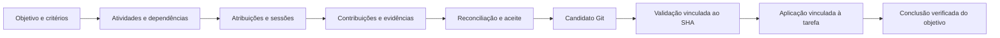

# Evolução dos upstreams e oportunidades para o Redcode

Estudo de 23 de outubro de 2026. Janela de commits: 25/set a 23/out, UTC.

A prioridade é absorver correções de execução e MCP, atualizar o contrato do
catálogo e terminar o ciclo de integração das atividades. A maior oportunidade
de produto é mostrar objetivo, dependências, responsáveis, evidências, custo e
integração no mesmo lugar. O Redcode já tem partes substanciais desse contrato;
trazer funcionalidades exige conectá-las e validá-las, sem criar outro scheduler.

Este documento registra pesquisa e propostas. Não registra adoção de código,
reprodução de vulnerabilidades, testes de provedores ou paridade concluída.

## Escopo e evidências

| Repositório                                           | Branch e revisão observada                          | Commits em quatro semanas | PRs abertos enumerados | Issues abertas enumeradas |
| ----------------------------------------------------- | --------------------------------------------------- | ------------------------: | ---------------------: | ------------------------: |
| [OpenCode](https://github.com/anomalyco/opencode)     | `dev` · `74f8d4860f49c563909e6b039b0cc8b454ebce72`  |                     1.177 |                  1.239 |                     2.432 |
| [models.dev](https://github.com/anomalyco/models.dev) | `dev` · `9ebbfc58e9c0b393a698aa6c022ecef4fe324b33`  |                     2.647 |                    228 |                       183 |
| [OpenBot](https://github.com/nightly-labs/openbot)    | `main` · `41444f7b2037410b6c6ae7ecad52058f5ebd4f51` |                     1.256 |                     33 |                       102 |
| **Total**                                             |                                                     |                 **5.080** |              **1.500** |                 **2.717** |

Os 4.217 itens abertos foram enumerados com título, descrição e metadados;
isso não significa leitura profunda de todos. Foram coletados detalhes, diffs e
discussões de 60 PRs selecionados, discussões de 22 issues e arquivos de código e
arquitetura. A comparação local é estática e orientada pelos temas prioritários.
Não foi feita auditoria completa dos três repositórios.

A coleta começou por volta de 09:29 UTC. Paginação, consulta de detalhes e
revisão ocorreram em momentos diferentes. Itens podem ter mudado de estado:
OpenBot #2881 e #2886 estavam no inventário de abertos e aparecem incorporados
na consulta posterior. Esses merges não estão necessariamente no head fixado.
O total anunciado pelo GitHub também oscilou durante a paginação. As listas
foram deduplicadas por número; não são uma fotografia transacional.

A branch `v2` do OpenCode permanece em
`4617210822bdbb31e5749751afbfb4584ccedac8`, de 10/out. Seus 560 commits da
janela também aparecem no inventário de `dev` e não foram contados novamente.
Há 489 commits do OpenCode, 1.322 do models.dev e 530 do OpenBot posteriores ao
corte da adoção de 12/out, `2026-10-12T17:03:03Z`. Volume de commits não mede
quantidade de funcionalidades: inclui sincronizações de catálogo e manutenção.

O checkout Redcode consultado é `main`,
`7362b918be9238be5092d2563405fe15f3b3aa2f`. A
referência de adoção anterior continua sendo [upstream-adoption.md](../upstream-adoption.md)
e o [ledger de paridade](../opencode-parity-ledger.json), que não declara paridade
completa. O estudo de OpenBot de 22/out já inventaria
[55 capacidades](openbot-orchestration-2026-10-22.md#inventário-de-funcionalidades-e-oportunidades).
Este estudo atualiza seu estado e acrescenta as outras duas fontes.

Arquivos para consulta e reprodução da seleção:

- [Commits enumerados](upstream-review-2026-10-23/commits.tsv), com SHA, data, título e link.
- [PRs e issues abertos enumerados](upstream-review-2026-10-23/open-items.tsv), inclusive os mais antigos.
- [PRs selecionados](upstream-review-2026-10-23/selected-prs.json), com estado, revisão e hash da coleta.
- [Manifesto de evidências](upstream-review-2026-10-23/evidence.json), com limites metodológicos e hashes dos 224 arquivos brutos/de fonte/detalhes.

Os recebidos completos ficam em `/var/tmp/redcode-upstream-study-20261023`.
Esse diretório é local e temporário; os índices e o manifesto ficam no repositório.
Parte das primeiras páginas usou o nome da branch; não foi feito clone para
provar independentemente a alcançabilidade de todos os SHAs. O manifesto conserva
as referências observadas e explicita páginas sem horário/URL original preservado.

O endpoint de releases do OpenCode retornou `v1.19.4` como primeiro resultado;
isso não identifica a última publicação de V2. Há um commit de sincronização
`v2.1.3` em `dev`, mas ele sozinho não prova publicação dos binários. OpenBot
retornou `v0.48.1`, de 22/out; models.dev retornou lista de releases vazia.

## OpenCode: correções que merecem o primeiro lote

“Correspondência no código” identifica o mesmo trecho ou condição no Redcode.
Não equivale a reproduzir o sintoma. “Investigar” exige traçar o contrato e
executar uma regressão local antes de decidir a correção.

| Tema e fonte                                                                                                                                          | Estado consultado                                          | Evidência no Redcode e decisão                                                                                                                                                                                                                           |
| ----------------------------------------------------------------------------------------------------------------------------------------------------- | ---------------------------------------------------------- | -------------------------------------------------------------------------------------------------------------------------------------------------------------------------------------------------------------------------------------------------------- |
| [#58349](https://github.com/anomalyco/opencode/pull/58349): startup MCP duplicado ou servidor desconectado ressuscitado                               | Incorporado                                                | `packages/core/src/mcp/index.ts` ainda agenda `fork(startServer(...).pipe(locks.withLock(name)))` sem verificar se a entrada já deixou `pending`. Correspondência direta; adaptar e testar as duas ordens connect/disconnect.                            |
| [#58351](https://github.com/anomalyco/opencode/pull/58351): shutdown MCP em paralelo                                                                  | Incorporado                                                | As conexões locais ainda usam `Scope.fork(root)`. O upstream introduz escopo de servidores com fechamento paralelo. Medir encerramento e ausência de processos órfãos com múltiplos servidores lentos.                                                   |
| [#58341](https://github.com/anomalyco/opencode/pull/58341): timeout implícito do fetch de Bun em MCP remoto                                           | Incorporado                                                | `packages/core/src/mcp/oauth.ts` usa `const base: FetchLike = fetch`; o upstream usa fetch sem idle timeout de Bun. Conservar deadline de execução e cancelamento MCP.                                                                                   |
| [#58342](https://github.com/anomalyco/opencode/pull/58342): requisição avulsa encerra login OAuth                                                     | Incorporado                                                | O callback local chama `fail` ao não encontrar `state`, encerrando o Deferred. Diferenciar requisição sem parâmetros de retorno OAuth inválido; testar que o login continua aguardando.                                                                  |
| [#58305](https://github.com/anomalyco/opencode/pull/58305): elicitation MCP no desktop/web                                                            | Incorporado                                                | Core cria `kind: "mcp-elicitation"`, mas `isSessionForm` aceita apenas question, websearch e Vault. `createSessionRequestModel` também não o seleciona. Lacuna concreta de seleção/renderização; implementar com DS React e respostas no Form existente. |
| [#58313](https://github.com/anomalyco/opencode/pull/58313): buffer de compactação maior que janela                                                    | Incorporado                                                | `calculateCeiling` local ainda retorna `window - buffer` para qualquer buffer definido. Correspondência direta; preservar a reserva padrão própria do Redcode ao descartar configuração inviável.                                                        |
| [#58396](https://github.com/anomalyco/opencode/pull/58396): arquivos especiais nos snapshots                                                          | Aberto                                                     | `Git.updateIndex` local filtra tamanho, mas não exclui tipos especiais. Adaptar no domínio Git; preservar arquivos regulares, links e gitlinks legítimos. A política exata ainda está em revisão upstream.                                               |
| [#58066](https://github.com/anomalyco/opencode/pull/58066), [issue #58394](https://github.com/anomalyco/opencode/issues/58394): rotação de credencial | Aberto                                                     | Core `Credential.update` já aceita valor e emite `Switched` para a credencial ativa; handler e Protocol de `credential.update` só passam label. Completar a superfície pública e regenerar Client, sem reconstruir a persistência.                       |
| [#58261](https://github.com/anomalyco/opencode/pull/58261): recuperação de subagentes após shutdown                                                   | Aberto                                                     | Já temos claims, owners locais e `SessionRestart.recoverSubagent`; falta a distinção `cancellationReason: shutdown` proposta no caminho Job → notificação. Investigar ordem de teardown: shutdown não pode virar resultado cancelado definitivo.         |
| [#57418](https://github.com/anomalyco/opencode/pull/57418): aguardar jobs antes do retorno de subagente                                               | Aberto                                                     | O aceite de contribuição já verifica trabalho pendente/descendente. Isso não comprova que toda notificação de conclusão aguarda os jobs. Comparar `SubagentJob` e `SubagentCompletion` separadamente.                                                    |
| [issue #58386](https://github.com/anomalyco/opencode/issues/58386): shell permanece visualmente rodando após reinício                                 | Relato aberto; reprodução descrita na discussão upstream   | `packages/server/src/process.ts` instala continuidade somente sob `if (lifecycle)`. Reproduzir modos managed, serve e standalone com armazenamento isolado. Não declarar resolvido só porque temos recovery.                                             |
| [issue #57582](https://github.com/anomalyco/opencode/issues/57582): retomadas duplicadas                                                              | Relato aberto; mantenedor não reproduziu o cenário simples | Redcode já possui gate atômico de execução local e owners. Manter essa proteção, testar coexistência de processos; não acrescentar um segundo scheduler.                                                                                                 |
| [#58391](https://github.com/anomalyco/opencode/pull/58391): `--server` e serviço duplicado                                                            | Aberto                                                     | Estudar parsing e seleção de servidor; exigir que conexão explícita não substitua o serviço ativo. O fluxo `dev:live` continua sendo a referência local.                                                                                                 |

O lote inicial deve privilegiar os seis primeiros itens: pequenas mudanças,
correspondências de fonte claras e regressões observáveis. Recovery e snapshots
precisam de cenários próprios; não entram como cherry-pick presumidamente seguro.

### Contratos, catálogo e funcionalidades novas

| Evolução                                                                                                                                                                                                                                                     | Como trazer para o Redcode                                                                                                                                                                                                                                     |
| ------------------------------------------------------------------------------------------------------------------------------------------------------------------------------------------------------------------------------------------------------------ | -------------------------------------------------------------------------------------------------------------------------------------------------------------------------------------------------------------------------------------------------------------- |
| [#57260](https://github.com/anomalyco/opencode/pull/57260), incorporado: V2.1 e unificação em `native`                                                                                                                                                       | O schema local ainda tem `providerState`, `providerResultState` e estados específicos. É migração pública de replay/import/export, não renomeação mecânica. Preservar leitura dos históricos, redaction, forks, compactação e consumidores antigos; gerar SDK. |
| [#57148](https://github.com/anomalyco/opencode/pull/57148), incorporado: refresh do catálogo para todo o servidor                                                                                                                                            | Confrontar eventos globais em `ModelsDev`/Provider e caches de todos os Locations. Um refresh em um cliente deve aparecer nos outros sem alterar a disponibilidade filtrada pelo RedRouter.                                                                    |
| [#57416](https://github.com/anomalyco/opencode/pull/57416), incorporado: manter Locations com execução/jobs                                                                                                                                                  | Já há adoções de espera humana, filhos e shell na localização original. Auditar o delta restante; não substituir as regras próprias por idle timer genérico.                                                                                                   |
| [#57626](https://github.com/anomalyco/opencode/pull/57626), incorporado: apenas instruções alteradas                                                                                                                                                         | Redcode já tem InstructionState, hashes, blobs e updates cronológicos. Validar diferença por fonte e compactação; não reintroduzir o snapshot inteiro em cada atualização.                                                                                     |
| [#56947](https://github.com/anomalyco/opencode/pull/56947), incorporado: Todo experimental                                                                                                                                                                   | Preservar Todo canônico com DAG, critérios, atribuição e evidência. Não regredir para uma lista opcional sem contrato de aceite.                                                                                                                               |
| [#57444](https://github.com/anomalyco/opencode/pull/57444), [#58294](https://github.com/anomalyco/opencode/pull/58294): compactação em background                                                                                                            | Já existe `compaction.background` em ConfigCompactionPlugin/SessionCompaction. Comparar política e invalidação; não anunciar como capacidade ausente.                                                                                                          |
| [#58194](https://github.com/anomalyco/opencode/pull/58194), incorporado: limites ChatGPT em plugin                                                                                                                                                           | Limite anunciado no catálogo não garante o limite da conta OAuth. Aplicar override por integração/conta com origem visível, sem contaminar modelos de outros provedores.                                                                                       |
| [#56767](https://github.com/anomalyco/opencode/pull/56767), [#57555](https://github.com/anomalyco/opencode/pull/57555), [#58162](https://github.com/anomalyco/opencode/pull/58162), abertos                                                                  | Estudar rejeição oversized não classificada, preservação de undo e resumo recolhido. Exigir regressões de replay/revert; a apresentação recolhida não pode ocultar decisões ou solicitações.                                                                   |
| [#57502](https://github.com/anomalyco/opencode/pull/57502), [#57504](https://github.com/anomalyco/opencode/pull/57504), [#57505](https://github.com/anomalyco/opencode/pull/57505), [#57506](https://github.com/anomalyco/opencode/pull/57506), incorporados | MCP hospedado pelo cliente permite ferramentas no terminal/navegador de quem se conecta. Não encontramos equivalente nessas superfícies locais. Projetar identidade do cliente, escopo da sessão, desconexão e autorização antes de expor ferramentas.         |
| [#55496](https://github.com/anomalyco/opencode/pull/55496), aberto: painel de subagentes                                                                                                                                                                     | Adaptar para Agents e DS React; abrir a Session filha existente e destacar contrato, progresso, bloqueio e evidência. Não manter outra conversa ou outro estado de tarefa.                                                                                     |
| [#58399](https://github.com/anomalyco/opencode/pull/58399), [#58400](https://github.com/anomalyco/opencode/pull/58400), abertos: Android/PWA e Web Push self-hosted                                                                                          | Evoluir notificações por dispositivo pareado; revogação, origem e ACL precedem envio. Usar atividade agregada por objetivo e intervenção, sem acordar modelo para produzir aviso.                                                                              |
| [#58379](https://github.com/anomalyco/opencode/pull/58379), [#58381](https://github.com/anomalyco/opencode/pull/58381), [#58382](https://github.com/anomalyco/opencode/pull/58382), abertos: novas rotas de avaliação                                        | Baseten/DigitalOcean locais expõem chat; Workers AI local também expõe chat. Ampliar rotas de avaliação em `@opencode/ai`, mantendo JEV/S1 tipado, disponibilidade real e contabilização. OpenAI Decisions é proposta, não protocolo já adotado.               |
| [#58383](https://github.com/anomalyco/opencode/pull/58383), [#58385](https://github.com/anomalyco/opencode/pull/58385), [#58387](https://github.com/anomalyco/opencode/pull/58387), abertos: imagens Alibaba/Vercel/Workers                                  | Temos ImageClient e geração no Design; faltam adapters específicos. Workers Run não é chat-compatible. Testar formatos binário/JSON/multipart e orçamento por chamada; modelo listado não prova geração funcional.                                             |
| Commits de heap snapshots, heap-dump CLI, watchers, Linux RPM/AppImage e musl                                                                                                                                                                                | Tratar diagnóstico, empacotamento e manutenção como trilha própria, com verificação do binário por plataforma. A presença do commit ou build verde não prova correção instalada.                                                                               |

## models.dev: evoluir o contrato, além de atualizar o snapshot

O snapshot local tem 225 provedores, 8.370 ofertas e 11 ofertas de decisão,
SHA-256 `231821b00f842fa58bf94f92ee51d1580364c5908b930eb5c829b7107d27d12c`.
Seu último commit é `04d89d68f384dd7457893e961799246041dc29a0`, de 2/out.
Esses números descrevem entradas de catálogo, não modelos acessíveis ou adapters
testados. O consumidor local e o do OpenCode consultado ainda usam o formato V1.

O models.dev agora publica um formato V2 por API/protocolo, com capacidades,
MIME types, compatibilidade e custos mais detalhados. O README e os geradores
mantêm V1 derivado dos arquivos schema-2 e validado por `v1:check`.
Portanto a existência do V2 não significa que `api.json` V1 tenha quebrado.

| Mudança ou problema                                                   | Fonte e estado                                                                                                                                                                                                                                                  | Adaptação proposta                                                                                                                                                                                                           |
| --------------------------------------------------------------------- | --------------------------------------------------------------------------------------------------------------------------------------------------------------------------------------------------------------------------------------------------------------- | ---------------------------------------------------------------------------------------------------------------------------------------------------------------------------------------------------------------------------- |
| Todas as APIs de um modelo e seus SDKs                                | [#10895](https://github.com/anomalyco/models.dev/pull/10895), incorporado                                                                                                                                                                                       | Distinguir oferta comercial, identidade do modelo e rota executável. Um modelo pode ter chat, responses, avaliação ou mídia com capacidades diferentes.                                                                      |
| Pacotes corretos para decisão, fala e rerank                          | [#10975](https://github.com/anomalyco/models.dev/pull/10975), incorporado                                                                                                                                                                                       | Resolver adapters conhecidos por contrato; não tratar qualquer nome de pacote do catálogo como código instalável autorizado.                                                                                                 |
| Remoção de mappings OpenCode adivinhados                              | [#10987](https://github.com/anomalyco/models.dev/pull/10987), incorporado                                                                                                                                                                                       | Ausência deve permanecer ausência. Não inventar SDK, endpoint ou acesso para preencher paridade.                                                                                                                             |
| `tools.updates`, `system_updates`, `effort_updates` sempre publicados | [#11134](https://github.com/anomalyco/models.dev/pull/11134), incorporado; [#11153](https://github.com/anomalyco/models.dev/pull/11153), documentação aberta                                                                                                    | Importar capacidades por protocolo e guardar origem/revisão. Local `supportsEffortUpdates` não representa sozinho as três dimensões.                                                                                         |
| Mudar effort pode destruir cache sem ser rejeitado                    | [#11175](https://github.com/anomalyco/models.dev/pull/11175), aberto                                                                                                                                                                                            | O probe corrigido usa sistema curto e texto grande em user; o controle preserva cache e a troca de effort o perde. Aceitar o parâmetro não prova atualização segura para cache. Não ativar otimização por nome/família.      |
| Preços de web search e expansão de custos                             | [#11059](https://github.com/anomalyco/models.dev/pull/11059), [#11135](https://github.com/anomalyco/models.dev/pull/11135), [#11136](https://github.com/anomalyco/models.dev/pull/11136), incorporados                                                          | Separar preço por token, imagem, segundo, requisição e busca; moeda, tiers, TTL e unidade devem chegar ao cálculo e à UI.                                                                                                    |
| Preço não informado versus gratuito                                   | [#9767](https://github.com/anomalyco/models.dev/issues/9767), [#9268](https://github.com/anomalyco/models.dev/issues/9268), issues abertas                                                                                                                      | `models-dev.ts` local normaliza custos ausentes para zero. Introduzir disponibilidade/origem da estimativa; preservar custo real do provedor e precedência RedRouter. Não há incidente de cobrança reproduzido neste estudo. |
| Preço por unidade, duração, TTL e região                              | [#5311](https://github.com/anomalyco/models.dev/issues/5311), [#5913](https://github.com/anomalyco/models.dev/issues/5913), [#2814](https://github.com/anomalyco/models.dev/issues/2814), [#1006](https://github.com/anomalyco/models.dev/issues/1006), abertas | Evitar um único número USD/Mtoken para operações de mídia ou cache. Cobertura de catálogo e cálculo precisam de contratos separados.                                                                                         |
| Campo `path` e System One                                             | [#11171](https://github.com/anomalyco/models.dev/pull/11171), aberto                                                                                                                                                                                            | `path` ainda é proposta na revisão fixada. Não construir consumidor que dependa desse campo como obrigatório; manter resolução explícita do endpoint.                                                                        |
| Novos provedores de decisão                                           | [#10818](https://github.com/anomalyco/models.dev/pull/10818), [#10633](https://github.com/anomalyco/models.dev/pull/10633), abertos                                                                                                                             | Cadastrar só após validar protocolo, identidade, autenticação, saída estruturada e disponibilidade de S1; catálogo não substitui integração.                                                                                 |
| Limites inconsistentes e attachment/modalidades contraditórios        | [#6073](https://github.com/anomalyco/models.dev/issues/6073), [#5792](https://github.com/anomalyco/models.dev/issues/5792), abertas                                                                                                                             | Validar no boundary e conservar incerteza. Uma regra universal output ≤ context exige semântica e evidência por protocolo; não “corrigir” toda a tabela por heurística.                                                      |
| Endpoint regional Alibaba                                             | [#11172](https://github.com/anomalyco/models.dev/issues/11172), [#7977](https://github.com/anomalyco/models.dev/pull/7977), abertos                                                                                                                             | Há conflito de documentação na discussão; o bot recusou mudança sem fonte primária válida. Confirmar plano/região antes de alterar endpoint.                                                                                 |
| Retenção, treinamento e identidades canônicas                         | [#2949](https://github.com/anomalyco/models.dev/issues/2949), [#8224](https://github.com/anomalyco/models.dev/issues/8224), [#2098](https://github.com/anomalyco/models.dev/issues/2098), abertas                                                               | Guardar desconhecido, padrão e opt-in distintamente. Identidade canônica não deve reescrever IDs executáveis nem prometer ZDR pela presença de um campo.                                                                     |

A sequência de catálogo recomendada é: atualizar e validar o snapshot V1;
introduzir versão/origem e normalização V2 compatível; distinguir custo desconhecido;
mapear flags por protocolo; acrescentar rotas de avaliação e mídia com testes reais.
A disponibilidade key-scoped e o roteamento continuam responsabilidade do RedRouter.

## OpenBot: produto e coordenação

O estudo anterior fixou `99e6ac5c61e2ceba1f20f64759cb5d72fe1aacb1`, de
22/out às 21:43 UTC. Há 15 commits novos até o head deste estudo: diagnóstico
de provedores, execução OpenCode travada, nomes MCP para ACP, configuração MCP
Codex com transportes diferentes, reconexão Gemini, lembretes, teste assinado de
webhook e ajustes mobile, menções, composer e marketplace. Isso atualiza a
análise anterior; não representa outra implementação do grafo no Redcode.

| Proposta ou relato                                                                                                                                                                                                                                                    | Estado consultado                                     | Oportunidade e limite                                                                                                                                                                                                                                        |
| --------------------------------------------------------------------------------------------------------------------------------------------------------------------------------------------------------------------------------------------------------------------- | ----------------------------------------------------- | ------------------------------------------------------------------------------------------------------------------------------------------------------------------------------------------------------------------------------------------------------------ |
| [#2885](https://github.com/nightly-labs/openbot/pull/2885): fallback por erro do provedor                                                                                                                                                                             | Aberto                                                | Até oito reservas, cooldown em memória e troca somente antes de trabalho (`!acted`). Em Redcode, preservar roteamento RedRouter, uma chamada por Physical Attempt e ausência de replay automático de ferramentas. Não promete troca transparente após saída. |
| [#2886](https://github.com/nightly-labs/openbot/pull/2886), [issue #2819](https://github.com/nightly-labs/openbot/issues/2819): motivo da falha no roteamento                                                                                                         | Incorporado na consulta posterior                     | Mostrar candidato, decisão determinística ou assistida, motivo e alternativa. Metadados operacionais bastam; não expor raciocínio privado.                                                                                                                   |
| [#2883](https://github.com/nightly-labs/openbot/pull/2883), [#2881](https://github.com/nightly-labs/openbot/pull/2881): ajustes de conta/reservas e edição em lote de agentes                                                                                         | Primeiro aberto; segundo incorporado posteriormente   | Ferramentas administrativas com autorização e resultado por agente. Não permitir ampliar permissões por alteração de perfil; falha parcial precisa ser explícita.                                                                                            |
| [#2874](https://github.com/nightly-labs/openbot/pull/2874): agente administra canal a pedido humano                                                                                                                                                                   | Aberto                                                | Converter em gestão de equipe/objetivo pelo contrato autorizado. Autor humano da mensagem não substitui ACL da pessoa ou do projeto.                                                                                                                         |
| [#2860](https://github.com/nightly-labs/openbot/pull/2860): registros órfãos ainda running no restart                                                                                                                                                                 | Aberto                                                | Separar execução real, projeção e apresentação. Nosso modelo difere; avaliar reparo por fatos persistidos e owners, sem apagar trabalho vivo.                                                                                                                |
| [#2870](https://github.com/nightly-labs/openbot/pull/2870): encerrar execuções OpenCode travadas e identificar run                                                                                                                                                    | Incorporado                                           | Diagnósticos devem carregar atribuição, sessão, harness, provedor e classe do erro; distinguir transporte encerrado de tarefa aceita.                                                                                                                        |
| [#2852](https://github.com/nightly-labs/openbot/pull/2852): lembrete único não publica resultado                                                                                                                                                                      | Aberto                                                | Rotinas precisam de política explícita de entrega. Silencioso porque não houve novidade é diferente de falha semântica.                                                                                                                                      |
| [#2865](https://github.com/nightly-labs/openbot/pull/2865): teste assinado de webhook                                                                                                                                                                                 | Incorporado                                           | Boa experiência para configuração verificável. Validar assinatura, janela temporal, tamanho, deduplicação e autorização antes de admitir no inbox. Não executar webhook durante a pesquisa.                                                                  |
| [#2821](https://github.com/nightly-labs/openbot/pull/2821): refresh token Google                                                                                                                                                                                      | Aberto                                                | Fluxo de OAuth precisa distinguir sessão curta de acesso offline. Aplicar por integração e preservar revogação; não forçar consentimento globalmente.                                                                                                        |
| [#2186](https://github.com/nightly-labs/openbot/pull/2186): repetição de falhas de ferramenta                                                                                                                                                                         | Aberto, com revisões solicitadas e ajustes discutidos | Aviso por padrão, parada configurável e identificação correta da sessão. Já temos observação passiva de repetição de reasoning; é sinal diferente. Política de interrupção exige avaliação para não parar reparos legítimos.                                 |
| [#1582](https://github.com/nightly-labs/openbot/pull/1582): confirms, escolhas e forms interativos                                                                                                                                                                    | Aberto                                                | Construir sobre Form/Question e DS React. Contratos tipados, fallback para clientes antigos e respostas duráveis; não renderizar HTML arbitrário do agente.                                                                                                  |
| [#1920](https://github.com/nightly-labs/openbot/issues/1920): workflows                                                                                                                                                                                               | Issue aberta; mantenedor distingue entregue e roadmap | Canvas, handoff e triggers existem; condições, aprovação, histórico completo e export ainda são roadmap na discussão. Não copiar esse roadmap como feature pronta.                                                                                           |
| [#2845](https://github.com/nightly-labs/openbot/issues/2845), [#2844](https://github.com/nightly-labs/openbot/issues/2844), [#2608](https://github.com/nightly-labs/openbot/issues/2608), [#2884](https://github.com/nightly-labs/openbot/issues/2884): transparência | Abertas                                               | Trace de modelo/ferramenta, mensagens entre agentes, visão de workers e eventos de memória/skill devem apontar para tarefas e fatos atuais. A UI não deve inferir sucesso de uma bolha de texto.                                                             |
| [#2742](https://github.com/nightly-labs/openbot/issues/2742), [#2804](https://github.com/nightly-labs/openbot/issues/2804), [#2813](https://github.com/nightly-labs/openbot/issues/2813): rotinas e execução                                                          | Abertas                                               | Isolar contexto por run, explicitar falha semântica e limites de concorrência/recursos. “Processo terminou” não significa “resultado aceito”.                                                                                                                |
| [#1836](https://github.com/nightly-labs/openbot/issues/1836), [#1634](https://github.com/nightly-labs/openbot/issues/1634), [#2499](https://github.com/nightly-labs/openbot/issues/2499), [#2463](https://github.com/nightly-labs/openbot/issues/2463): memória       | Abertas                                               | Escopo, origem, revisão, opt-in de sincronização/aprendizado e opção de desligar. Contexto do objetivo não deve virar memória global implícita.                                                                                                              |

### Cobertura funcional, além do problema de orquestração

A matriz de 55 capacidades de 22/out continua como inventário de produto. Não
foi possível certificar todas as combinações de plataforma, adapter e estado.
As famílias abaixo garantem que a trilha de adoção não esqueça funções adjacentes.
“Base” descreve capacidade correspondente, não equivalência completa.

| Família                                             | Base Redcode                                                  | Trabalho que permanece                                                                                                                  |
| --------------------------------------------------- | ------------------------------------------------------------- | --------------------------------------------------------------------------------------------------------------------------------------- |
| Agentes persistentes, perfil e equipe               | Configuração de agentes e harnesses                           | Perfil compartilhável, composição de equipe revisável e gestão em lote.                                                                 |
| Múltiplos runtimes, ACP e descoberta local          | Engine próprio e harnesses externos                           | Matriz real por adapter; conformance, replay de transcripts sanitizados e canary de versões. Não adicionar dez drivers sem testes.      |
| Fila, steer, pausa, retomada e crash recovery       | Inbox e execução duráveis                                     | Agregar estados por objetivo, testar shutdown/restart e clientes desconectados.                                                         |
| Objetivo, divisão, dependências e delegação         | Goal, Todo DAG, atribuições e sessões filhas                  | UI comum e propagação para workers/harnesses; um responsável final.                                                                     |
| Reconciliação e integração de código                | `task_reconcile`, prepare/apply Git e proveniência por tarefa | Recibo de validação vinculado ao SHA candidato e aplicação consciente da tarefa.                                                        |
| Canais, mensagens e síntese de contribuições        | Relações pai/filho e retorno sintético                        | Contexto compartilhado versionado, comunicação vinculada à tarefa e agrupamento de conclusões.                                          |
| Memórias, busca e dados estruturados compartilhados | Histórico, leitura por sessão e instruções persistidas        | Memória por escopo com origem/controle, busca e banco de trabalho; estado do scheduler continua canônico.                               |
| Skills, plugins, templates e marketplace            | Skills, MCP, Agent tools e extensões                          | Revisões imutáveis, procedência, proteção a alterações locais e export/import sem credenciais.                                          |
| Rotinas, calendário, flows e webhooks               | Monitores, jobs, APIs e inbox                                 | Scheduler de rotinas, revisão imutável do fluxo, DST/timezone, missed runs, triggers e entregas. Monitores não são agenda.              |
| Navegador e Computer Use                            | Browser nativo e Computer Use opcional                        | Coordenação de tabs/recursos, takeover humano e capacidades por plataforma. Perfis autenticados não são permissão para qualquer agente. |
| Anexos, arquivos e prévias                          | Ferramentas de arquivo, Design e artefatos                    | Identidade, hash, origem e disponibilidade dos entregáveis entre workers; transferência controlada.                                     |
| Entregas visuais, imagens e sites                   | Design e pipeline de mídia                                    | Mais rotas de mídia, publicação/revogação de sites e resultado visual vinculado à atividade.                                            |
| Voz                                                 | Ditado no TUI e APIs de mídia                                 | STT/TTS e conversa de voz no desktop são ampliação distinta.                                                                            |
| Desktop, web, mobile e push                         | Desktop/web e PWA responsivo                                  | Push pareado; app nativo iOS/Android e Live Activity são projeto separado.                                                              |
| Slack, Discord, Telegram e mailbox                  | API/CLI de sessões                                            | Adapters de entrada/saída com identidade, ACL, deduplicação e correlação de objetivo; e-mail externo não é inbox interno.               |
| Contas, papéis e equipe remota                      | Infraestrutura, autorização e workers                         | Rever matriz de papéis por ação, pessoa, projeto e agente; não compartilhar credencial do dono implicitamente.                          |
| Self-hosting, transporte remoto e hospedagem        | Servidores, workers e containers                              | WebRTC/relay, hospedagem e billing são trilhas de infraestrutura; integrar com a plataforma existente quando houver escopo.             |
| Uso, quotas, custo, logs e saúde                    | Budget, uso, diagnósticos e provider health                   | Visão por objetivo/atividade, custo desconhecido, razão de bloqueio e vínculo com execução.                                             |
| Atualização, distribuição e compatibilidade         | Releases, contratos, Client e builds próprios                 | Provar binários publicados, preservar execuções ativas e negociar capacidades; não importar lote de dependências por volume.            |
| Acessibilidade, idiomas, temas e notificações       | DS React, i18n e preferências existentes                      | Completar Agents no DS e validar interface real; notificar intervenção e síntese, com detalhes sob demanda.                             |

## Segurança: aplicabilidade antes de concluir vulnerabilidade

| Evidência                                                                                                                                                | Conclusão para nós                                                                                                                                                                                                                                                                                          |
| -------------------------------------------------------------------------------------------------------------------------------------------------------- | ----------------------------------------------------------------------------------------------------------------------------------------------------------------------------------------------------------------------------------------------------------------------------------------------------------- |
| [OpenCode #52083](https://github.com/anomalyco/opencode/issues/52083), #49948 e #54393: semântica de shell/permissões                                    | Temos scanner nativo e testes de redirects, pipelines e PowerShell em `shell-scan`, `permission.test.ts` e `tool-shell.test.ts`. Isso reduz a necessidade de copiar parsing upstream, mas não prova imunidade a todos os relatos. Revalidar o contrato por execução direta e Code Mode, sem rodar exploits. |
| [OpenCode #50652](https://github.com/anomalyco/opencode/issues/50652): permissões de plugins                                                             | O registry local filtra ferramentas proibidas e compartilha hooks de execução, mas isso não comprova o prompt `ask` para cada plugin externo/nested call. Prioridade de investigação com fixture benigna e autorização negada; não declarar falha confirmada.                                               |
| [OpenCode #57827](https://github.com/anomalyco/opencode/pull/57827), incorporado: escopo de installation token GitHub                                    | A correção é no serviço de exchange upstream. Não encontramos sua implementação aqui; o CLI contém clientes desse endpoint. Mapear quem emite o token no deployment Redcode e limitar ao repositório verificado se o serviço existir. Código incorporado upstream não prova correção implantada.            |
| [models.dev #10336](https://github.com/anomalyco/models.dev/issues/10336): SVG inline                                                                    | Os ProviderIcons React locais usam sprites empacotados e nomes conhecidos, não o SVG remoto desse renderer upstream. Não há correspondência demonstrada nesse caminho. Outras superfícies de HTML/SVG permanecem fora dessa conclusão.                                                                      |
| [OpenCode #58293](https://github.com/anomalyco/opencode/pull/58293), aberto: Linux chrome-sandbox                                                        | Validar permissões do artefato Electron efetivamente distribuído. Renderer sandbox e permissões das ferramentas são limites diferentes; não usar `--no-sandbox` como correção.                                                                                                                              |
| [OpenCode #50904](https://github.com/anomalyco/opencode/issues/50904) e [OpenBot #86](https://github.com/nightly-labs/openbot/issues/86): segredos e LLM | Preservar Vault e referências opacas resolvidas na execução. Redação de logs não impede segredo no request; autofill de browser não equivale a credenciais para jobs/API. Não prometer detector universal nem substituição reversível sem modelo de autorização.                                            |
| [OpenBot #1357](https://github.com/nightly-labs/openbot/issues/1357), [#1967](https://github.com/nightly-labs/openbot/issues/1967), #1924 e #2745        | APIs limitadas por escopo, papéis de agente, política de provedor e rotação de chave do host devem ser verificadas no servidor. Participação em canal ou instrução de agente não concede autoridade.                                                                                                        |
| [OpenCode #58193](https://github.com/anomalyco/opencode/issues/58193): instruções não encontradas no histórico                                           | A discussão não confirma injeção pelo cliente: pode haver replay do próprio modelo ou comportamento do gateway. Propor diagnóstico sanitizado das instruções realmente enviadas, com origem/hash; não atribuir causa sem request ou evidência do servidor.                                                  |
| [OpenCode #57985](https://github.com/anomalyco/opencode/issues/57985): identidade de projeto muda ao adicionar remote                                    | Investigar adoção/migração de Project ID, sessões e regras de permissão. Corrigir só a lista visível poderia separar histórico e autorização. Não executar SQL corretivo em bases reais como parte do estudo.                                                                                               |

Os documentos SECURITY dos upstreams também distinguem permissões do agente de
isolamento do sistema operacional. A autorização de ferramentas, o isolamento do
renderer e o sandbox de worker precisam de contratos próprios. Esta pesquisa não
reproduziu falhas de segurança nem certificou o deployment local.

OpenCode e models.dev usam MIT. O [LICENSE fixado do OpenBot](https://github.com/nightly-labs/openbot/blob/41444f7b2037410b6c6ae7ecad52058f5ebd4f51/LICENSE)
é **PolyForm Noncommercial 1.0.0**, embora o metadata da API diga NOASSERTION.
Oportunidades do OpenBot devem ser implementadas independentemente nos contratos
Redcode; não presumir autorização para copiar/vendorizar sua implementação em
um produto comercial.

## Orquestração: o que já evoluiu e o próximo fechamento

Desde a referência Redcode do estudo anterior, já temos no código:

1. Todo canônico com dependências, vínculo de tarefa a Session filha, proveniência
   da contribuição e invalidação transitiva.
2. `task_reconcile` e leitura tipada de contribuições, resultados, verificações,
   sobreposições e bloqueios.
3. Preparação de candidato Git de múltiplos worktrees, conflitos explícitos e
   aplicação de revisão exata.
4. Preparação vinculada à tarefa, escolha dos insumos aceitos e fingerprint do
   contrato. Concluir exige verificação posterior à preparação.

Fontes locais principais: `packages/core/src/session/todo.ts`,
`task-assignments.ts`, `task-reconciliation.ts`, `task-integration.ts`,
`packages/server/src/task-integration.ts` e `packages/core/src/worktree.ts`.

O gate atual de conclusão verifica sucesso, tipo da prova e horário posterior à
preparação. Ele **ainda não é um recibo de teste do SHA candidato**. Uma verificação
em outro checkout pode ser recente sem validar a árvore integrada. Aplicar um
candidato Git também não equivale a concluir uma atividade ou o objetivo.

Ainda faltam recibos de validação por candidato, aplicação consciente da tarefa,
Agents DS React por objetivo, notificações agrupadas, grafo nos workers/harnesses,
contexto comum versionado e workflows reutilizáveis. Não devemos apresentar essas
etapas como concluídas por existir `prepare` ou uma coleção de respostas.

## Sequência recomendada e critérios de aceite

| Lote                              | Entrega                                                                                                                       | Evidência necessária para encerrar                                                                                                                                                    |
| --------------------------------- | ----------------------------------------------------------------------------------------------------------------------------- | ------------------------------------------------------------------------------------------------------------------------------------------------------------------------------------- |
| **1 — Execução confiável**        | MCP startup/shutdown, fetch, OAuth callback, elicitation React e buffer inválido; investigação dirigida de recovery/snapshots | Regressões antes/depois; processos encerrados; callback continua aguardando; formulário real em desktop/web; compactação com janela válida.                                           |
| **2 — Credenciais e catálogo**    | Rotação pública, snapshot atualizado, normalização V1/V2, flags por protocolo e custo desconhecido                            | Client gerado; consumidores antigos compatíveis; rotação ativa propaga sem restart; hash/contagens; desconhecido nunca apresentado como grátis; estimativa separada da cobrança real. |
| **3 — Integração verificável**    | Recibo com candidato SHA/tree, comando, resultado, contexto e proveniência; apply vinculado à tarefa                          | Validar no checkout candidato; rejeitar prova de outro SHA/checkout e candidato obsoleto; registrar aplicação sem inventar execução exatamente uma vez.                               |
| **4 — Transparência no DS React** | Visão objetivo → tarefas → agentes → bloqueios → evidências → integração; abrir sessões existentes                            | Browser real em telas estreita/larga, teclado e acessibilidade; estados de falha/parcial/obsoleto; controles nos mesmos contratos; notificações agrupadas.                            |
| **5 — Equipe e automação**        | Grafo remoto, contexto versionado, recursos, workflows, rotinas e webhooks                                                    | Reinício e reatribuição seguros; revisão de plano fixa; resultados parciais explícitos; timezone/DST; duplicação de trigger não duplica admissão; ACL por ação.                       |
| **6 — Expansão de produto**       | Mais adapters de avaliação/mídia, memória/skills, conectores, voz, push e eventualmente mobile                                | Matriz por plataforma/protocolo; validação com provedor real; custos e limites; origem de conteúdo e revogação. Não tratar catálogo como teste de acesso.                             |

Segurança acompanha os lotes: investigação de plugin/Code Mode, tokens GitHub,
identidade de projeto e artefatos Electron devem produzir evidência de
aplicabilidade antes de virar correção ou declaração pública.

Cada capacidade adotada deve entrar no ledger com fonte/revisão, contrato
Redcode, estado por superfície, regressão, evidência de execução e pendências.
Estados úteis: **enumerado → estudado → aplicável → implementado → validado →
publicado**. Um PR aberto ou uma issue com solução sugerida permanece proposta
até a implementação e a verificação locais. O objetivo é cobertura funcional
com critérios explícitos; este estudo não certifica que já temos todas as funções.

## Verificação desta entrega

Foram conferidos contagens e unicidade dos índices, metadados dos PRs, hashes
dos arquivos recebidos e existência dos caminhos locais citados. Não foram
executados testes de runtime, fluxos de navegador ou chamadas pagas. Os testes
mencionados nos PRs são evidência relatada pelos upstreams, não resultados desta
sessão. A entrega altera somente documentação e índices de pesquisa.
