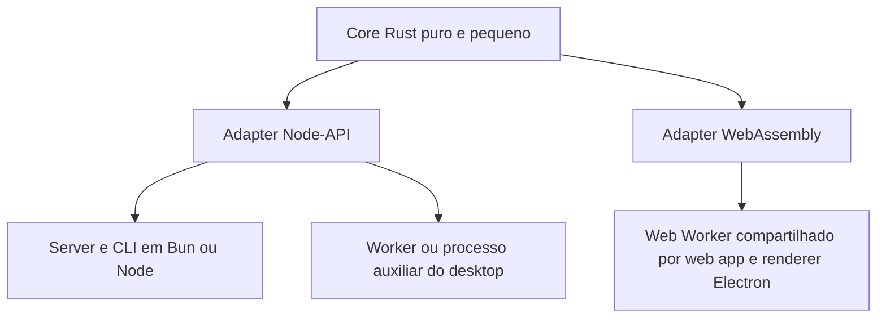

# Viabilidade de Rust no RedCode

Estudo em 13/11/2026. Escopo: exclusivamente RedCode — server/core, web app,
desktop Electron, componentes compartilhados e implicações para CLI/TUI.

A recomendação é uma migração seletiva, orientada por profiling. Usar **rustify
como apoio ao acompanhamento** de módulos escolhidos e aproveitar do
**rust-rewrite os princípios de revisão e equivalência**. A primeira entrega deve
ser um módulo pequeno integrado ao produto e medido de ponta a ponta. A evidência
atual não justifica reescrever o servidor inteiro nem trocar o Electron.

O ciclo de decisão, shadow mode, promoção, desligamento e deleção está definido em
[rust-migration-methodology.md](rust-migration-methodology.md). Esse documento é o
ledger operacional do programa; este estudo permanece como sua base técnica.

## Base e limites do estudo

- Clone: `C:/Users/filip/Work/redcode`, HEAD
  `10ee87a1d4e1e883ae66315951399e1273d981ac`, release no commit `0.87.29`.
- O clone já tinha alterações locais, inclusive no ciclo de vida de Locations,
  sincronização do cliente e diagnósticos de memória. Elas foram preservadas e
  fazem parte da fonte observada; não se presume que estejam na versão instalada.
- `rustify`: revisão `bbf9ac726e4fbf511a77a4c9e818cd8fb7f9bcb7`.
- `rust-rewrite`: revisão `0c043e9582c9da7c9f7ceb1c2787da9ff9efd61c`.
- Foram lidos README, configuração e implementação dos dois projetos. Nenhuma
  ferramenta de migração foi instalada ou executada, e não houve port para Rust.
- Foi executado somente um benchmark isolado já existente no RedCode, descrito
  abaixo. Não houve profiling completo de CPU nem reprodução do incidente de OOM.
- Nenhum processo instalado foi reiniciado. Não houve mudança de código de runtime,
  configuração, providers, branches, commits ou publicação neste estudo.

Os dados brutos e hashes de arquivos consultados estão em
`C:/Users/filip/artifacts/redcode-rust-study-2026-11-13/`:
`location-memory.json` e `provenance.json`. A identidade do benchmark é HEAD mais
working tree; não é uma comparação entre releases limpas.

## Onde cada parte executa

| Superfície    | Implementação observada                                                                | Consequência para Rust                                                                                    |
| ------------- | -------------------------------------------------------------------------------------- | --------------------------------------------------------------------------------------------------------- |
| Servidor/core | `packages/server`, `core`, `ai`; TypeScript, Effect, adaptadores Bun/Node/workerd      | Extrair funções computacionais; preservar serviços, cancelamento, plugins e contratos                     |
| Web app       | `packages/app`, `client`, `session-ui`, `ui`; Solid e componentes React, workers e DOM | Rust acessível por WebAssembly ou pelo servidor; addon nativo não executa no browser                      |
| Desktop       | `packages/desktop`, renderer compartilhado e `gui-extensions`                          | Melhorias do renderer beneficiam web e desktop; main, GPU e páginas embutidas têm custos separados        |
| CLI/TUI       | `packages/cli`, `tui` e dependências compartilhadas                                    | Extrações no core podem beneficiar estas superfícies; preservar distribuição do executável e cancelamento |
| Contratos     | `schema`, `protocol`, `client` gerado                                                  | Não substituir tipos, API e codecs sem compatibilidade e geração apropriada                               |

Inventário aproximado das pastas `src`, contando linhas físicas TS/TSX, sem
`*.test.*`: core 140.908; server 15.487; app 140.822; desktop 9.643;
session-ui 20.907; client 35.079; ai 31.536; cli 19.936; tui 73.225;
gui-extensions 64.517. A contagem inclui comentários, localização e código gerado
quando presentes; não representa quantidade de lógica a portar ou estimativa de prazo.

## Comparação das ferramentas

| Critério             | rustify                                                              | rust-rewrite                                                                       |
| -------------------- | -------------------------------------------------------------------- | ---------------------------------------------------------------------------------- |
| Entrega              | CLI Rust para analisar e acompanhar o port                           | Skill e sete scripts de orquestração de agentes                                    |
| Estratégia           | Módulos em ordem de dependências; ciclos agrupados                   | Draft amplo, stubs, compilação parcial, implementação completa, testes e auditoria |
| Origem mais alinhada | TypeScript/JavaScript                                                | Método e exemplos fortemente centrados em Zig e ownership de ponteiros             |
| Produção de Rust     | Não escreve a implementação                                          | Depende de agentes e do runtime de workflows                                       |
| Convivência TS/Rust  | Índice com hashes de origem e testes; ratchet no CI                  | A principal ênfase é convergir a reescrita e revisar equivalência                  |
| Verificação          | Comparação de comandos, saídas e arquivos; inventário e proveniência | Revisores separados, testes existentes e remoção de stubs                          |
| Adequação ao RedCode | Melhor ponto de partida para extrações graduais                      | Referência metodológica; adaptação considerável para uso direto                    |

O grafo e o ratchet estão implementados, não são apenas instruções no README.
Entretanto, um hash atualizado registra a origem declarada do port: não comprova
equivalência semântica nem ganho de desempenho. O comparador de processos também
não substitui um harness de HTTP/SSE, IPC ou UI.
[Fontes: rustify README](https://github.com/ArchAstro/rustify/blob/bbf9ac726e4fbf511a77a4c9e818cd8fb7f9bcb7/README.md),
[grafo](https://github.com/ArchAstro/rustify/blob/bbf9ac726e4fbf511a77a4c9e818cd8fb7f9bcb7/src/graph.rs),
[ratchet](https://github.com/ArchAstro/rustify/blob/bbf9ac726e4fbf511a77a4c9e818cd8fb7f9bcb7/src/ratchet.rs).

Há trabalho de adaptação no rustify: o resolver observado trata imports relativos,
builtins e exports de workspaces, mas não implementa resolução de `tsconfig.paths`
nem de `package.json#imports`. RedCode usa aliases `@/` e seletores como `#fff` e
`#sqlite`, com implementações distintas por runtime. Esses imports podem ser
classificados como externos e deixar o grafo incompleto. É necessário validar o
inventário e adaptar o resolver ou preparar uma fronteira de módulos sem esses
aliases. O manifesto consultado informa versão 0.1.0, Rust mínimo 1.88 e
`publish = false`; convém fixar a revisão utilizada.
[Resolver](https://github.com/ArchAstro/rustify/blob/bbf9ac726e4fbf511a77a4c9e818cd8fb7f9bcb7/src/packages.rs),
[manifesto](https://github.com/ArchAstro/rustify/blob/bbf9ac726e4fbf511a77a4c9e818cd8fb7f9bcb7/Cargo.toml).

No rust-rewrite, os scripts pressupõem primitivas `agent`, `pipeline`, `parallel`
e `args` do ambiente Workflow; não são programas Node/Bun independentes. O prompt
de draft conserva regras específicas de Bun/Zig, inclusive restrições a `std`,
`async` e Tokio, que não devem ser transplantadas para o RedCode. A proposta de
manter o workspace incompleto por fases também exige um alvo isolado da entrega
normal. Aproveitar revisão independente, contratos e planejamento de ownership;
não adotar literalmente o fluxo de reescrita em massa. O relato sobre a migração
do Bun não foi usado para estimar prazo, custo ou ganhos do RedCode.
[Skill estudada](https://github.com/Fldicoahkiin/rust-rewrite/blob/0c043e9582c9da7c9f7ceb1c2787da9ff9efd61c/SKILL.md),
[draft](https://github.com/Fldicoahkiin/rust-rewrite/blob/0c043e9582c9da7c9f7ceb1c2787da9ff9efd61c/workflows/draft-port.workflow.js),
[runtime esperado](https://github.com/Fldicoahkiin/rust-rewrite/blob/0c043e9582c9da7c9f7ceb1c2787da9ff9efd61c/references/workflow-orchestration.md).

## Evidência de memória do RedCode

### Incidente documentado no desktop

[transport-performance.md](../transport-performance.md) registra OOM no Linux
com pico de 16G no escopo da aplicação após aproximadamente cinco horas. É um
registro anterior, não uma medição deste estudo, e não atribui 16G ao backend.
O mesmo documento relata uma reprodução isolada em que o console do Chromium
retinha objetos; `Runtime.discardConsoleEntries` liberou essa retenção.
O descarte já aparece em `packages/gui-extensions/src/browser/diagnostics.ts`.

Portar o consumidor desses eventos para Rust não faria o Chromium liberar
automaticamente os objetos. Em `browser/chromium.ts`, as páginas embutidas usam
`backgroundThrottling: false`; a política de atividade de páginas ocultas merece
medição, preservando navegação e automações de agentes em segundo plano.
Não há evidência aqui para desligar indiscriminadamente essa opção.

### Benchmark executado neste estudo

Windows, Bun 1.4.4, três Locations, três instâncias isoladas de plugin e dois
ciclos de carga/liberação. Diretórios temporários, banco em memória, rede e
watchers desabilitados, sem modelos/provedores disponíveis. O catálogo de origem
continha 228 providers e 9.323 modelos; cada população reportou 7.577 definições
e zero modelos disponíveis. O script força GC para medir heap retido.

| Primeiro ciclo de Locations | Heap usado |        RSS |
| --------------------------- | ---------: | ---------: |
| Antes                       | 111,53 MiB | 316,69 MiB |
| Após carregar três          | 151,57 MiB | 398,93 MiB |
| Após invalidar/liberar      | 125,69 MiB | 389,02 MiB |

Incrementos de heap por Location: 19,41; 10,42; 10,22 MiB. Após a segunda
liberação, heap 129,17 MiB. A queda de cerca de 25,9 MiB após a primeira
liberação mostra recursos liberáveis. O resíduo e a variação entre dois ciclos
não provam vazamento: aquecimento, estruturas compartilhadas e comportamento do
alocador precisam ser separados. RSS não acompanha necessariamente o heap
liberado. Não extrapolar estes valores por projeto para produção.

Comando executado a partir de `packages/core`:

```powershell
bun run script/benchmark-location-memory.ts --locations 3 --plugins 3 --cycles 2 --json C:/Users/filip/artifacts/redcode-rust-study-2026-11-13/location-memory.json
```

Uma leitura pontual do Windows também encontrou um `redcode.exe` com argumento
de servidor, 408,6 MiB de working set e 630,0 MiB de memória privada comprometida.
São métricas distintas; não somá-las nem chamar memória comprometida de RAM
residente. Nenhum processo Electron/renderer foi identificado pelo filtro usado.
Essa leitura não mede crescimento, não identifica a revisão do binário e não
diagnostica o OOM histórico.

### Pontos a medir antes de uma reescrita

| Código                                                  | Observação verificável                                                                   | Implicação                                                                                           |
| ------------------------------------------------------- | ---------------------------------------------------------------------------------------- | ---------------------------------------------------------------------------------------------------- |
| `core/src/location-services.ts`, `location-activity.ts` | Graphs em LayerMap; política própria de expiração, atualmente cinco minutos para ociosos | Conferir liberação de scopes, serviços, watchers, MCP e índices; há mudanças locais neste fluxo      |
| `client/src/solid/data.ts`                              | Mudança local evita reabrir catálogo por eventos após shutdown por inatividade           | Validar cliente e backend juntos; trocar linguagem só no backend não elimina a reativação            |
| `app/src/session/timeline/cache.ts`                     | Até 16 views, incluindo views destacadas e suas mensagens                                | Limite por quantidade não define limite de bytes; medir retenção com históricos grandes              |
| `session-ui/src/components/markdown-cache.tsx`          | 200 entradas com texto original e HTML                                                   | Medir volume e descarte; sem orçamento explícito em bytes neste cache                                |
| `session-ui/src/components/session-diff.ts`             | 16 entradas; chave contém o patch e valor contém representação para o viewer             | Medir coexistência de texto, linhas e metadados; limite por quantidade                               |
| `session-ui/src/pierre/worker.ts`                       | Dois pools lazy possíveis, dois workers por pool, highlighter WASM                       | Contar workers realmente criados e seus heaps; migrar mais código para WASM não elimina esses custos |
| `app/src/workspaces/files/content-cache.ts`             | 40 entradas/20 MiB aproximados, com itens protegidos da evicção                          | Já existe política por bytes; não presumir teto absoluto para arquivos protegidos                    |
| `server/src/event-feed.ts`                              | Limites de 4 MiB por subscriber e 4 MiB para replay                                      | Não é uma fila ilimitada; conferir assinantes lentos, ciclo de desconexão e total agregado           |

Estas são hipóteses e fronteiras de investigação, não uma lista de vazamentos
confirmados. O modelo multiprocesso do Electron exige medir processos distintos;
melhorias no servidor não removem os renderers, GPU ou browser embutido.
[Modelo de processos](https://www.electronjs.org/docs/latest/tutorial/process-model),
[orientação de performance](https://www.electronjs.org/docs/latest/tutorial/performance).

## Módulos candidatos e trabalho estimado

Estimativas de planejamento para uma pessoa experiente em TypeScript/Rust, com
apoio de agentes, incluindo adaptação e testes. Não são medições de produtividade
ou promessas; dependem de confirmar um gargalo. Os prazos não são somáveis porque
infraestrutura de bindings e distribuição é compartilhada.

| Prioridade                     | Módulo/fronteira                                                                                                  | Hipótese de ganho                                                         | Trabalho de produção estimado                                                           |
| ------------------------------ | ----------------------------------------------------------------------------------------------------------------- | ------------------------------------------------------------------------- | --------------------------------------------------------------------------------------- |
| Primeiro candidato de RAM      | Índice e ranking de caminhos em `core/src/filesystem/search.ts`                                                   | Manter índice compacto fora do heap JS; retornar somente top-k            | 2–4 semanas; menor se o adapter FFF existente atender às plataformas e ao contrato      |
| Bom piloto pequeno             | Parsing/contagem/normalização de patches em `core/src/vcs/patch.ts` e `session-ui/src/components/session-diff.ts` | Menos scans e intermediários em patches grandes                           | 1–2 semanas de PoC; 3–5 semanas para integração nativa + web, conforme paridade         |
| Candidato de CPU compartilhado | Projeção incremental de Markdown em `session-ui/src/components/markdown-stream.ts`                                | Evitar reparse de prefixos longos durante streaming                       | 1–2 semanas de PoC; 4–8 semanas com semântica, cancelamento e integração                |
| Condicional                    | Serialização/processamento de eventos e histórico                                                                 | Reduzir CPU/cópias se o profile mostrar domínio desse custo               | 3–6 semanas para uma fronteira delimitada; baixa prioridade atual                       |
| Adiar                          | Session runner, Effect, plugins, HTTP server completo                                                             | Possível redução do runtime apenas se parte significativa for substituída | Projeto de meses; sem estimativa responsável antes de inventário de contratos           |
| Adiar                          | Substituição do shell Electron                                                                                    | Outra arquitetura de processos/integração nativa                          | Projeto separado de meses, com browser embutido, CDP, IPC, armazenamento e distribuição |

**Busca:** no Windows, sem configuração explícita, a implementação seleciona o
caminho ripgrep + índice JavaScript. O scan já usa um executável; o alvo seria o
`Map` de nomes preparados e o ranking, não reescrever o ripgrep. A atualização
constrói um índice novo enquanto o anterior ainda existe. Nas outras condições
há adapter `@ff-labs/fff-bun`; investigar seu uso e limitações antes de criar
outro motor. Preservar projetos remotos: `workspaceID` seleciona execução pelo
ambiente remoto e não pode indexar o filesystem local por acidente.

**Patches:** Git já calcula boa parte dos diffs nativamente. Começar pela fronteira
pura de leitura/normalização, preservando paths com aspas, renames, CRLF, Unicode,
ausência de newline, truncamento e alinhamento de hunks. Evitar começar pelo motor
de aplicação de patches, que também envolve efeitos e transações. Um parser
mais rápido terá pouco impacto se seus objetos grandes continuarem retidos no JS.

**Markdown:** o pipeline já usa workers e Shiki; não é tudo processamento no
thread principal. `project()` otimiza um caso de bloco de código aberto, mas outros
casos voltam a `stream(text, live)`. Medir padrões concretos antes de substituir.
Preservar Markdown incompleto, tabelas, matemática, links locais, sanitização,
identidade dos blocos e semântica de streaming. O DOM e o HTML retidos continuam
custando memória mesmo que o parser seja Rust.

**Alvos fracos:** `core/src/util/token.ts` apenas estima tokens por comprimento/4;
não é um tokenizer pesado. SQLite já é acessado pelo binding nativo `bun:sqlite`.
Git, ripgrep e dependências nativas não se tornam automaticamente mais eficientes
ao reescrever seus wrappers TypeScript.

## Arquitetura de integração proposta



Para funções puras, considerar `napi-rs` no backend e WASM em worker na UI.
Bun implementa Node-API, mas o próprio projeto diz que a maioria dos addons
funciona: validar o binding e as versões reais em todas as plataformas suportadas.
Manter fallback para ambientes como workerd e para indisponibilidade do binário.
[napi-rs](https://napi.rs/docs/introduction/getting-started),
[Node-API no Bun](https://bun.sh/docs/runtime/node-api),
[WASM no JavaScript](https://developer.mozilla.org/en-US/docs/WebAssembly/Guides/Using_the_JavaScript_API).

Um sidecar Rust pode ser adequado a um índice persistente e oferece isolamento;
adiciona processo, protocolo, filas e custo de transporte. Não presumir que sua
RAM total será menor. Para qualquer opção, preferir operações em lote e formatos
compactos; evitar copiar todo o histórico por IPC a cada token. Se o objetivo é
reduzir RAM, o Rust precisa ser dono do estado pesado, com liberação explícita,
sem manter uma segunda cópia equivalente em JS. Addon síncrono pesado também
bloqueia o event loop: trabalho computacional deve executar fora dele.

## Plano de execução e critério de decisão

1. **3–5 dias úteis para baseline e seleção.** Fixar a revisão e identificar
   binários em uso. Aproveitar os diagnósticos existentes e concluir a avaliação
   das mudanças locais de ciclo de vida. Medir server, renderer, workers,
   main/GPU, páginas embutidas e filhos MCP/LSP/PTY separadamente. Não sobrepor
   benchmarks com builds/typechecks.
2. **5–10 dias úteis para uma PoC.** Escolher busca ou parser de patches conforme
   o profile. Definir contrato, dados de entrada, ownership, erro e cancelamento.
   Comparar TypeScript atual, TypeScript otimizado e Rust. Testar lotes pequenos
   e grandes; incluir conversão, IPC e cold start na medida.
3. **5–10 dias úteis adicionais para consolidar um módulo pequeno aprovado.**
   Integrar packaging Windows/macOS/Linux e arquiteturas suportadas; CI,
   observabilidade, fallback e rollback. O caminho WASM e a compatibilidade de
   ambientes podem ampliar o prazo. Primeiro resultado produtivo: ordem de
   grandeza de 3–5 semanas, não uma reescrita geral.

Usar as suítes existentes como âncoras: `core/test/filesystem/search.test.ts`,
`core/test/patch.test.ts`, `core/test/location-layer.test.ts`,
`server/test/event-feed.test.ts`, testes `session-diff`/`markdown-stream` e os
benchmarks de timeline, retenção, Markdown e review em `app/e2e/performance`.
Executar testes diferenciais de entradas iguais, incluindo Unicode e offsets
UTF-16, cancelamento, truncamento e resultados vazios. Hashes do rustify ajudam
a manter a origem em dia; não dispensam esses testes.

Cenários: idle, abertura de projeto, grandes repositórios, streaming longo,
review de patches, troca/fechamento repetido de sessões e páginas embutidas com
console ativo. Incluir soak de 4–8 horas, pois o incidente documentado foi tardio.
Separar runs frias/quentes e repetir A/B em ordem alternada. Medir CPU por operação,
p50/p95/p99, atraso do event loop, tempo de frame/long tasks, bytes copiados,
heap JS, memória nativa/WASM, RSS/working set e crescimento após fechar recursos.

Como critério inicial proposto, exigir benefício relevante no cenário afetado
(por exemplo, pelo menos 20% no p95 ou 25% no pico de memória), sem regressão
funcional e sem penalidade material no caminho comum. Esses números são critérios
a calibrar, não ganhos previstos. Um kernel 5x mais rápido que ocupa 10% do tempo
total melhora o total em aproximadamente 9%, antes de contabilizar integração.

A decisão final deve priorizar impacto por esforço: corrigir retenção pode
resolver a pressão de RAM antes de qualquer port. Rust entra onde ownership de
dados e processamento medido justificam manter mais uma implementação e sua
cadeia de distribuição.
